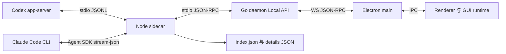
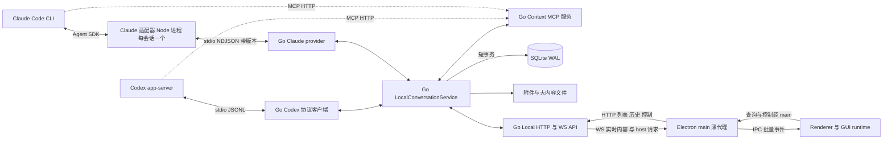

# 本地对话流 Go 直连与 SQLite WAL 方案

日期：2026-10-29。状态：待评审的实施方案，架构迁移尚未开始。代码现状基于 `f13b9f9b5`（已包含 #73 的本地对话传输打点）。

将本地 Codex 与 Claude 对话的状态和存储统一交给 Go 守护进程：Go 直接连接 Codex app-server；Claude 继续使用官方 Agent SDK，由 Go 为每个会话启动一个只做执行适配的 Node 进程。实时内容通过 WebSocket 推送给 Desktop，列表与历史通过 HTTP 按需读取，会话与事件持久化到独立的 SQLite 数据库并开启 WAL。迁移完成后删除现有的共享 Node sidecar。

本方案同时处理重复读取、无界缓冲和重启恢复三个问题。移除 Node 中转本身不能保证没有积压；每一段队列仍需明确容量、消费方式和失败行为。

## 1. 已定方向与范围

### 1.1 已定方向

| 项目 | 方案 |
| --- | --- |
| Codex 运行链路 | Go 直接启动、监管并连接 app-server |
| app-server 到 Go | 保留原生 stdio JSONL 协议，去掉 Node 中转 |
| Claude 运行链路 | 继续使用 `@anthropic-ai/claude-agent-sdk`；Go 为每个 Claude 会话启动一个 Node 进程（Claude 适配器），只负责调用 SDK，不持有会话状态、不写存储（§4.4） |
| Provider 边界 | 两个 provider 在 Go 内实现同一接口；会话状态、存储、事件归一化、MCP 托管只在 Go |
| 共享 Node sidecar | 迁移完成后删除：现有承载全部会话、状态与 JSON 存储的单一 sidecar 及其协议 |
| Go 到 Desktop 实时数据 | WS 携带文本、思考、工具调用与结果等实际内容 |
| 会话列表、项目列表、历史 | HTTP 查询，分页且限制响应大小 |
| 订阅 | 一条 WS 连接上分两层：scope 级摘要流和会话级内容流 |
| 断线后的内容补齐 | 订阅时携带 `after_seq`，服务端先从库回放再切换实时（追赶式订阅） |
| 持久化 | 存储在本机；Go 独占写入 SQLite + WAL；流式内容逐条持久化后才推送，保留全部事件；附件内容保留在文件系统 |
| 状态所有者 | Go 是公共会话状态的唯一写入方，Desktop 保存展示状态 |
| 事件合批 | 大小和从首条事件起的时间双阈值，关键事件立即提交；单写入方跨会话合并提交 |
| 并发上限 | 全局最多 20 个运行中轮次，跨 provider 与会话计数 |
| 协议定义 | v2 wire 协议由单一 schema 生成 Go 与 TS 代码 |
| 旧数据 | 不导入旧 JSON 会话；新库从空开始，旧文件保留在磁盘上不读不删 |
| 平台 | 本轮验收 macOS；Windows 不在本轮范围 |

### 1.2 本轮能力边界

必须保留 Codex 与 Claude 已有的会话续接、模型与推理强度、权限模式、MCP 上下文、取消和 steer、用户问题、图片与附件、导入与 fork、Side 会话、标题、用量和消息队列；Claude 另需保留后台任务（启动、进度、停止与结果投递）和原生历史读取。不能用仅支持文本发送的新实现替换现有完整能力。

`@智能体` 的云端调用维持现有云端链路；这次不重设计云端任务系统和 P2P / Relay，不修改 Codex 与 Claude 自己的会话文件或数据库，不重做界面。

不在本轮范围：旧 JSON 会话导入（§10）、现有 Node 链路的止血补丁（§3 方案 B）、Windows 验收。从 Codex / Claude 原生历史导入会话的现有能力仍需保留，用户可以通过它重新接入原生会话。

**Claude 采用 SDK + Node 形式。** Claude 不在 Go 中重新实现 CLI 协议，继续使用官方 Agent SDK：运行、运行中改参数、后台任务、fork 与原生历史读取都调用 SDK。为避免现有共享 sidecar 的问题（一个进程承载所有会话，一次写入错误使全部会话中断），改为每个 Claude 会话一个 Node 进程，由 Go 启动和监管，进程内不保存会话状态、不写存储、不托管 MCP。这一形态参考 Tutti 已在生产使用的 `claude-sdk-sidecar`（每会话一个进程、带版本号的 NDJSON 协议、Go 持有状态与 SQLite）。

本文给出推荐默认值。API、表结构及资源上限属于方案设计，尚未成为已实现的协议或实测性能结论。

## 2. 现状与证据

### 2.1 当前数据流



当前 HTTP Local API 提供 hello 和文件传输；会话请求由 WS `request` 转发给 sidecar。因此，"列表和历史走 HTTP"是本方案的目标行为，不能描述成当前实现。

Go Local API 已有三项会被本方案替换或改造的机制：1024 条的内存事件环形缓冲及 `instance:seq` 游标、游标失效时的 `resync`，以及 sidecar 发起、按连接定向投递给 Desktop 的 `hostRequest`（Side workspace、settings host、开发者日志导出）。现有游标绑定 sidecar 实例，实例重建后序号失效；这是 §5.2 改用持久化会话序号的直接原因。

sidecar 当前从 CLI profile 配置读取 Multica API 凭据，并直接调用云端 API（上下文、工作区工具、云端队列）；令牌不是由 Electron main 转发给 sidecar 的。

高频输出的当前路径如下：

1. app-server 通知到达 Node，转换成轮次事件，追加到内存中的 `turn.events`。
2. `changed()` 立即发送变更通知。200 ms 定时器只合并磁盘保存，不合并变更通知。
3. Desktop 收到变更后使会话与工作区数据失效，GUI runtime 重新读取会话。
4. `loadSession()` 先加载会话，再为历史轮次调用 `task.messages`。
5. 当前 `task.messages` 在 renderer 侧先读取整份会话，数据经过 Node → Go → Desktop 后，才筛选对应轮次。
6. 这会放大序列化、传输和读取成本；Node 的协议输出没有按 `write()` 的返回值等待 drain。

现有代码已经有同一会话的 in-flight 请求合并、dirty 后续刷新和最多 4 个历史轮次并发读取。不能据此推导"每个 token 都启动一次完整并发读取"，也不能直接用事件速率乘整份历史大小来估算实际流量。

### 2.2 已确认与待验证

| 证据 | 观察 | 可支持的结论 |
| --- | --- | --- |
| E-01：2026-10-29 02:48:07 PDT 崩溃日志 | Node 报 `write ENOBUFS`，Socket 的 error 未被处理，sidecar 退出码 1 | 本次是 sidecar 的写入错误导致退出；不是仅凭 UI 推测整个 Desktop 崩溃 |
| E-02：隔离写入复现 | 不处理背压的大批写入能复现相同 `_writev` / `clearBuffer` 异常；处理 drain 的对照用例完成 | 无背压积压是可以复现的故障机制，但不能代替现场通道与队列证据 |
| E-03：当前代码读取链路 | 每次 changed 可引发历史刷新，按轮次取消息仍先传输整会话 | 存在重复大响应的结构性放大，见 §2.1 的调用路径 |
| E-04：sidecar 监管与连接初始化 | sidecar 可重启；Desktop 已建立的 WS 不因此必然重新发送 `session.set` | 重启后可能出现 `Call session.set before sending requests`，解释了持续重试现象 |
| E-05：当前存储代码 | `index.json` 与 `details/<sha256>.json`，有旧 `conversations.json` 导入逻辑 | Multica 的这份会话历史当前不是 SQLite |

**根因边界：** 已确认的直接退出原因是未处理的 `write ENOBUFS`。现场堆栈没有指出具体文件描述符或写入通道；"sidecar stdout 积压到超大批量"仍是待验证假设。隔离复现中约 2.3 GB 的逻辑队列量不代表现场达到该值。新打点用于确认通道、队列字节、请求来源和大响应关联。

证据到设计的对应关系：E-01 / E-02 → 有界写入和错误传播；E-03 → 实时增量与历史查询分离；E-04 → 明确实例代次和恢复状态机；E-05 → Go 接管独立会话库。

### 2.3 代码依据

| 范围 | 当前代码 |
| --- | --- |
| Node 直连 Codex | [local-codex-rpc.ts](../../apps/desktop/src/local-host/local-codex-rpc.ts)、[local-codex-worker.ts](../../apps/desktop/src/local-host/local-codex-worker.ts)、[local-codex-pool.ts](../../apps/desktop/src/local-host/local-codex-pool.ts) |
| Node 经 Agent SDK 运行 Claude | [local-claude-conversation.ts](../../apps/desktop/src/local-host/local-claude-conversation.ts)、[local-provider-models.ts](../../apps/desktop/src/local-host/local-provider-models.ts)、[local-native-history.ts](../../apps/desktop/src/local-host/local-native-history.ts)、[local-provider-fork.ts](../../apps/desktop/src/local-host/local-provider-fork.ts) |
| Context MCP 与凭据读取 | [local-context-mcp.ts](../../apps/desktop/src/local-host/local-context-mcp.ts)、[local-codex-context-bridge.ts](../../apps/desktop/src/local-host/local-codex-context-bridge.ts)、[sidecar-host.ts](../../apps/desktop/src/local-host/sidecar-host.ts) |
| 事件追加与变更通知 | [local-conversation-service.ts](../../apps/desktop/src/local-host/local-conversation-service.ts) |
| JSON 存储 | [local-conversation-store.ts](../../apps/desktop/src/local-host/local-conversation-store.ts) |
| Node 协议输出与本次打点 | [json-rpc.ts](../../apps/desktop/src/local-host/json-rpc.ts)、[rpc-diagnostics.ts](../../apps/desktop/src/local-host/rpc-diagnostics.ts) |
| Go 监管与 Local API | [sidecar.go](../../server/internal/daemon/localhost/sidecar.go)、[server.go](../../server/internal/daemon/localhost/server.go) |
| Desktop 代理与读取适配 | [local-conversation-proxy.ts](../../apps/desktop/src/main/local-conversation-proxy.ts)、[renderer service](../../apps/desktop/src/renderer/src/platform/local-conversation-service.ts) |
| 历史刷新与请求合并 | [create-multica-agent-gui-runtime.ts](../../packages/tutti-agent-gui-host/src/runtime/create-multica-agent-gui-runtime.ts) |
| Go 已有 Codex 协议实现 | [codex.go](../../server/pkg/agent/codex.go) |
| Go 已有 Claude 协议实现 | [claude.go](../../server/pkg/agent/claude.go)、[claude_supplement.go](../../server/pkg/agent/claude_supplement.go)、[claude_models.go](../../server/pkg/agent/claude_models.go) |
| sidecar 发现与启动 | [manifest.go](../../server/internal/daemon/localhost/manifest.go) |
| Go 已有 SQLite 使用 | [store.go](../../server/internal/p2pserver/store.go)、[go.mod](../../server/go.mod) |

已有 [Node sidecar 技术方案](./local-conversation-daemon-sidecar.md) 和 [实施计划](./local-conversation-daemon-sidecar-plan.md) 用于说明历史设计。本方案替换其中两个 provider 的运行、公共状态存储及增量传输边界，并最终删除 sidecar；旧文档中的实现状态不代表本方案已落地。

## 3. 根本方案与兼容方案

| 方案 | 实现方式 | 收益与限制 | 定位 |
| --- | --- | --- | --- |
| A：Go 接管状态与存储 | Go 管 Codex、全部公共会话状态和 SQLite；Claude 执行按 D′；WS 实时内容 + HTTP 历史 | 删除共享 sidecar，消除中转和整会话刷新放大；迁移范围较大，需完整能力验收 | 推荐目标 |
| B：现有链路止血 | Node 写入等待背压、处理 Socket 错误、`task.messages` 按轮次过滤后再返回、合并变更通知，并修复重建后的初始化 | 可较快降低当前故障风险；状态和数据仍经过 Node | 不做；精力集中在 A |
| C：仅把 provider 客户端移到 Go | Go 收到输出后再交给 Node 管状态，Node 再回传 Go | 仍有跨进程往返、重复序列化和 Node 数据通路 | 不作为目标架构 |
| D：Go 管 Codex，Claude 留在一个共享的 Node SDK 进程 | 单个 Node 进程运行全部 Claude 会话并上报事件 | 一次写入错误仍会中断所有 Claude 会话；保留共享 sidecar 的监管与初始化问题 | 不采用 |
| D′：Go 管 Codex，每个 Claude 会话一个 SDK 进程 | Node 进程只调用 SDK 并上报原始 SDK 消息，状态与存储在 Go | 故障限于单个会话；fork 与原生历史直接用 SDK；协议跟进由 SDK 负责；需保留 Node 运行时 | **采用**，作为 A 中 Claude 部分的实现方式 |

选择 A 后可分阶段开发，但同一会话在任一时刻只能有一个状态所有者。A 完成后共享 sidecar 整体删除，Node 只以每会话 Claude 适配器的形式存在。不单独发布 B；迁移完成前现有链路维持现状，A 上线即替换。接口混合版本的兼容通过明确能力协商处理，不通过隐式双写或静默重放处理。

JSON 存储本身不是这次退出的直接原因，但它是选择 SQLite 的依据：`local-conversation-store.ts` 每次保存把整份会话详情 `JSON.stringify` 后原子替换，长会话的写入量随历史长度增长，且无法在存储层按轮次或范围读取。

## 4. 目标架构与模块位置



Electron main 仍承担原生能力（Side workspace、原生选择框等）、Desktop 登录态、网络连接和 IPC。删除的是现有的共享 Node sidecar；Electron 主进程和每会话 Claude 适配器进程都保留。

建议代码位置如下，目录尚未创建：

| 位置 | 职责 |
| --- | --- |
| `server/pkg/codexappserver/` | 子进程、initialize、JSONL 编解码、请求关联、双向 RPC、通知与退出 |
| `apps/desktop/src/claude-host/`（新增，取代 `src/local-host/` 中的 Claude 部分） | Claude 适配器：调用 Agent SDK，按 §4.4 协议与 Go 通信；打包为独立入口，以 Electron Node 模式运行 |
| `server/internal/localconversation/` | 会话与轮次状态、provider 接口与调度、事件归一化、消息队列、历史与恢复 |
| `server/internal/localconversation/provider/codex`、`provider/claude` | Codex：进程池与常驻 thread；Claude：每会话适配器进程的启动、监管、请求关联与原始 SDK 消息归一化 |
| `server/internal/localconversation/contextmcp/` | Context MCP 服务、工作区与 Side 工具、每轮凭据绑定 |
| `server/internal/localconversation/store/` | SQLite schema、单写协程、快照与历史查询、schema 升级与备份 |
| `server/internal/daemon/localhost/` | 复用现有监听、鉴权和文件入口，增加 HTTP 查询与增量 WS 协议 |
| `apps/desktop/src/main/local-conversation-proxy.ts` | 能力协商、HTTP / WS、重连、原生交互与批量 IPC |
| `apps/desktop/src/renderer/src/platform/` | wire DTO 校验和转换、增量应用、历史分页 |
| `packages/tutti-agent-gui-host/` | 本地增量事件接入，保留云端数据源行为 |

从 `server/pkg/agent/codex.go` 提取通用协议能力之前，先区分任务调度逻辑与纯协议逻辑（传输层已拆到 `server/pkg/codexappserver`）。云端 backend 是"一个任务一次运行"，本地需要常驻多轮会话；协议层由两者共用，会话层分开实现。不能为了复用，把本地会话强行转换成云端运行。

`localconversation` 从第一阶段起定义 provider 接口，至少覆盖：启动或续接会话、提交轮次、steer、取消、运行中修改模型 / 推理强度 / 权限、回答交互请求、模型列表、原生历史读取与 fork，以及向服务层上报原始 provider 事件。事件归一化在服务层按 provider 实现，结果是同一套 v2 事件类型；Claude 适配器只上报原始 SDK 消息，不做归一化，因此不存在第二种语言的归一化实现。SDK 消息与 CLI stream-json 消息结构一致，Go 侧可复用 `pkg/agent/claude.go` 已有的消息解析。

### 4.1 Context MCP 与凭据

Context MCP 服务迁到 Go，Codex 与 Claude 指向同一服务；Claude 适配器把 Go 下发的 MCP 地址与凭据原样传给 SDK 的 `mcpServers`。当前 Claude 读取配置中的 HTTP MCP 地址，Codex 经 context bridge 绑定每轮路由，两者都不依赖进程内 SDK MCP server，因此切换只改服务地址与路由绑定。保留现有约束：每轮独立凭据、仅绑定 127.0.0.1、拒绝带 Origin 的请求、限制请求体、轮次结束释放路由。Go 需新增 MCP 服务实现依赖，选型在 P0 确定。

Go daemon 直接使用 CLI profile 凭据调用云端 API，替代 sidecar 的 `readProfileCredentials`；凭据不进入 provider 的持久化配置、事件、日志或 Desktop 状态。Desktop 登录账号与 profile 账号的一致性继续沿用现有 `session.set` 中的 `not_signed_in` / `account_mismatch` 校验语义。

### 4.2 共享 sidecar 删除范围

完成切换后删除：`server/internal/daemon/localhost/sidecar.go` 的共享 sidecar 监管、daemon 与共享 sidecar 之间的协议、`apps/desktop/src/local-host/` 下被 Go 取代的模块（状态、存储、Codex、MCP、上下文与工具）和对应打包产物。

保留并改造：Electron 以 Node 模式运行的能力与 manifest 发现规则，用于启动每会话 Claude 适配器；manifest 中的入口改为 Claude 适配器入口和它的协议版本。只有 Desktop 安装的 daemon（manifest 位于同一安装目录）才提供本地对话；独立安装的 CLI daemon 不因逻辑移入 Go 而自动获得该能力。

原 `hostRequest` 改为 Go 服务直接发起：Side workspace 控制、settings host 和开发者日志导出仍按连接定向投递给发起该工作的 Desktop，保留"连接不存在立即失败、超时不确认结果、只能由同一连接回复"的语义。

### 4.3 app-server 到 Go 的通信选择

第一版使用 Go 的 `os/exec` 和 stdin / stdout 管道，保持 `app-server --listen stdio://`。单个写入协程串行写完整 JSONL 帧；读取协程持续读取并分类处理响应、通知和服务端请求。stderr 独立排空，不能混入协议或默认原样写进日志。

stdio 已由当前 Go backend 和本地 Codex 客户端使用，去掉中间转发后即可减少一次 Node 排队及跨进程序列化。是否具有最高吞吐量需要基准测试，本方案不作未测量的性能排名。

原生协议还支持 Unix socket；它使用 WebSocket over UDS 和 HTTP Upgrade，并非任意自定义二进制流。可作为后续传输替换点。TCP WebSocket 当前被官方标为实验性且不受支持，不作为本轮默认依赖。协议事实见 [Codex App Server 协议](https://learn.chatgpt.com/docs/app-server#protocol)。

协议客户端必须有请求超时与取消、进程退出时清空 pending、有限帧大小、完整短写处理和初始化失败传播。不要使用默认 64 KiB 上限的 Scanner 直接读取可能较大的 JSONL；超限必须返回可诊断错误，不能静默截断。以上要求同样适用于 Go 与 Claude 适配器之间的连接。

Codex 原生协议类型参考 Tutti `codexproto` 的做法：由 Codex 上游导出的 JSON Schema 生成 Go 类型，并固定到具体的 Codex 版本，替代手写的 `map[string]any` 解析。

本地 Codex 会话层在云端实现之外还需保留：按配置代次隔离的进程池与空闲回收、常驻 thread 与 `thread/unsubscribe` / `thread/closed` 处理、`CODEX_PLUGIN_ISOLATION_ARGS`、每轮 MCP 路由绑定，以及只以 `turn/start` 响应确定新轮次（resume 可能重放旧通知）。

### 4.4 Claude 适配器（SDK + Node）

**进程模型。** Go 为每个需要运行的 Claude 会话启动一个 Claude 适配器进程（Electron Node 模式，入口见 §4.2），进程内用 Agent SDK 的 `query()` 维持该会话的常驻多轮 Query。轮次结束后进程保留以承接后续轮次，空闲超时或会话关闭时由 Go 结束进程；进程数受 §6.3 全局并发上限约束。fork、原生历史列表与读取、模型列表等不依附运行会话的操作，由 Go 启动一次性适配器进程执行，完成即退出。

**职责边界。**

| 在 Claude 适配器内 | 在 Go 内 |
| --- | --- |
| 调用 SDK：`query()`、`interrupt()`、`setModel`、`setPermissionMode`、`applyFlagSettings`、`setMcpServers`、`stopTask`、`forkSession`、`listSessions`、`getSessionInfo`、`getSessionMessages`、`supportedModels` | 会话与轮次状态、消息队列、命令幂等、SQLite 存储 |
| 把 SDK 消息原样（加会话、请求关联标识）写给 Go | 原始 SDK 消息的归一化、最终事件合成、后台任务状态 |
| 把 SDK 的权限回调与用户问题转成请求发给 Go，等待 Go 的回答 | 交互请求持久化、抢占式回答（§8.3） |
| 使用 Go 下发的 MCP 地址与凭据 | Context MCP 服务、云端凭据 |

适配器不读写会话库和 JSON 存储，不调用 Multica 云端 API，不做标题生成、上下文组装或事件归一化。

**Go ↔ 适配器协议。** stdin / stdout 上的换行分隔 JSON：

- 每条消息带协议版本号，任一方收到不支持或缺失的版本时直接报错退出，不猜测兼容（参考 Tutti 做法）。版本号写入 manifest，并纳入 §5.6 的 schema 与黄金样例。
- Go → 适配器：`start`（cwd、resume、fork 选项、模型、推理强度、权限模式、追加系统提示、MCP 配置）、`send`（用户消息与请求标识）、`interrupt`、`set_model`、`set_permission_mode`、`apply_flag_settings`、`set_mcp_servers`、`stop_task`、`answer`（交互请求的回答）、`close`；一次性进程的 `fork_session`、`list_sessions`、`get_session_messages`、`supported_models`。
- 适配器 → Go：`sdk_message`（原始 SDK 消息）、请求结果、`interaction_request`（权限确认与用户问题）、结构化错误（稳定错误码与"已拒绝 / 未派发 / 结果未知"等派发结论，Go 依据它决定命令受理结果，不解析错误文本）。
- **写入必须处理背压**：适配器写 stdout 时遵守 `write()` 返回值等待 `drain`，并处理流的 error 事件；本次 `write ENOBUFS` 退出不能在适配器中重现。Go 读取端按 §6.2 持续读取，不因存储变慢暂停。
- stderr 只用于诊断日志，不承载协议；不记录提示词、工具入参、凭据和原始输出。

**故障隔离。** 适配器进程退出只影响对应会话：运行中轮次按 §8.2 明确失败，交互请求关闭；下一次发送时 Go 重新启动适配器并以 `resume` 续接原生会话。

**fork 与原生历史。** 直接使用 SDK 的 `forkSession()`（支持截断到指定消息）与 `getSessionMessages()` / `listSessions()`，不在 Go 中解析 transcript。原生对账（§5.4）同样通过一次性适配器读取 transcript。

**SDK 版本。** SDK 版本由仓库锁定，随 Desktop 一起发布；它对应的最低 Claude Code CLI 版本按 §4.5 检测。升级 SDK 时以其类型定义与变更说明为准，更新适配器与 Go 侧的消息解析样例。

**参考：SDK 调用与底层协议的对应关系（静态核对，SDK 0.3.310 / Claude Code 2.1.310）。** 便于排查问题和理解 SDK 行为，不作为 Go 直连 CLI 的实现依据：

| SDK 调用 | 底层协议 |
| --- | --- |
| `setModel(model)` | control `set_model`，字段 `model` |
| `setPermissionMode(mode)` | control `set_permission_mode`，字段 `mode` |
| `applyFlagSettings(settings)` | control `apply_flag_settings`，字段 `settings`（本地用于修改推理强度 `effortLevel`） |
| `setMcpServers(servers)` | control `mcp_set_servers`，字段 `servers` |
| `stopTask(id)` | control `stop_task`，字段 `task_id` |
| `interrupt()` | control `interrupt`，可选 `cancel_queued` |
| `supportedModels()` | `initialize` 响应中的 `models` |
| `systemPrompt` 追加、hooks | 随 `initialize` control 请求下发 |
| `forkSession()` | TS 内重写 transcript 文件（处理 compaction、sidechain、UUID 重映射等），不经过 CLI |

### 4.5 Provider 版本要求

每个 provider 声明最低支持版本和所需能力。Go 在首次启动 provider 时检测：Codex 读取 `initialize` 响应中的版本信息；Claude 由适配器在 SDK 初始化后上报 Claude Code CLI 版本与能力，最低版本取锁定 SDK 所对应的 CLI 版本。检测结果按"可执行文件路径 + 文件指纹"缓存，文件变化后重新检测。

不满足要求时不启动轮次，也不让进程崩溃：命令受理结果和会话中各返回一条可读错误消息，说明当前版本、最低版本和受影响能力；模型列表等接口返回同一错误码。部分能力缺失（例如某个 control 子命令不支持）时，只禁用对应操作并在执行该操作时返回消息，其余能力照常使用。最低版本在 P0 确定。

## 5. 实时事件与历史查询

### 5.1 传输分工

| 数据 / 操作 | 通道 | 规则 |
| --- | --- | --- |
| 文本、思考、工具调用、工具结果 | WS | 直接推送增量内容，不能只推 changed 后读取整会话 |
| 轮次开始、结束、失败、取消 | WS | 携带状态和必要数据，立即提交与推送 |
| 交互请求（权限确认、用户问题）及其结果 | WS | 持久化后推送给该会话的所有订阅者；回答抢占式受理（§8.3） |
| 会话列表、项目列表、搜索 | HTTP | 首次读取与翻页 |
| 会话摘要变更（状态、标题、排序时间、待回答、队列数、新建 / 归档） | WS scope 级订阅 | 直接推送变更后的摘要，不触发列表重新读取 |
| 首屏、历史消息、历史事件 | HTTP | 有界分页，按会话和轮次过滤后再序列化 |
| WS 缺口补齐 | WS 订阅回放 | 订阅携带 `after_seq`，服务端从库回放（§5.3） |
| 发送、取消、steer、回答、队列控制 | HTTP | 带请求标识，返回受理结果；执行进度走 WS |
| 工具输出 | WS | 按 provider 给出的内容原样放进事件，本轮不做摘要、截断或转文件引用 |
| 附件与生成图片 | HTTP 文件读取 | WS 推送元数据与引用，二进制不内联 |

正文分片属于实时内容，普通输出不因分片而退回整会话读取。工具输出不丢弃、不截断；大工具输出的分页或文件化在有实际数据后另行评审。

### 5.2 序号与事件语义

以 `scope + conversation_id` 为事件流边界，使用会话级单调递增 `seq`。数据库重启后继续增长，不以 daemon 的实例编号重新从零开始。恢复游标同时携带 `store_generation`；数据库被恢复或替换导致代次变化时，客户端重建快照，不能沿用旧库游标。

scope 级摘要流另有 scope 内单调递增的 `scope_seq`：任何改变会话摘要的事务在同一事务内递增它，并把新值写到该会话摘要的 `summary_seq`。

事件全部保留，不在轮次结束后压缩或删除 delta；`event` 表是事实来源，`message` 和会话摘要由事件推导、可重建。存储增长通过 WAL 与数据库大小指标观测，是否引入压缩在有实际数据后另行评审。

每条持久化事件至少包含 `conversation_id`、`turn_id`（会话级事件可为空）、`seq`、`type`、`created_at` 和类型对应的 `payload`。批次包含 `from_seq`、`to_seq`、`events` 和协议版本。批次只负责运输，事件顺序不因重新合批而变化。

当前 GUI 的 `task.messages` 使用轮次内 `seq`。新事件另保留 `turn_seq`，本地适配器用它映射现有 GUI；会话级 `seq` 用于传输与补齐。

以下是新协议的**示意格式**，不是现有 WS 协议：

```json
{
  "version": 2,
  "type": "conversation.events",
  "conversation_id": "session-example",
  "from_seq": 101,
  "to_seq": 102,
  "events": [
    { "seq": 101, "turn_id": "turn-example", "turn_seq": 21, "type": "text.delta", "payload": { "text": "开始" } },
    { "seq": 102, "turn_id": "turn-example", "turn_seq": 22, "type": "text.delta", "payload": { "text": "处理" } }
  ]
}
```

**输出块与最终事件。** 轮次内的输出按块组织：一段助手回复、一段思考、一次命令执行、一次文件变更、一次工具调用、一张生成图片、一个后台任务，各有 provider 给出的 `item_id`（Codex item id、Claude content block 或 `tool_use_id`）。每种事件归入两类之一：

- **追加**：内容拼接到该块已有内容之后，例如文本 delta、思考 delta、命令输出 delta。
- **最终**：携带该块的完整状态，替换之前拼接的结果，例如 Codex `item/completed`、Claude 完整 content block。

规则：

1. 每个块以且仅以一条最终事件（`final = true`）结束，带完整内容和类型字段（全文、命令与退出码、diff、工具名与入参、附件引用、错误）。
2. provider 的完成事件不带全文，或块被取消、失败、进程退出中断时，由 Go 归一化合成最终事件：内容为已收到部分，状态为 `cancelled` / `failed`。
3. 会多次变化状态的块（后台任务）每次变化写一条状态事件，最后一条为最终事件。
4. 客户端收到最终事件时用它替换该块，不与 delta 再做拼接或比对；最终输出不能再作为 delta 追加。
5. 最终事件替代独立的 item 投影表（§7.2）：读取已完成块只读最终事件，读取进行中的块读该块的 delta。

事件类型和 DTO 在协议阶段逐项映射两个 provider 的已有能力后固定。

新 HTTP / WS wire DTO 使用 `snake_case`，TS 边界转换为 `camelCase` 并通过 schema 校验。原生 app-server 字段、旧 v1 字段和已有 GUI 协议保持各自语义，不能全局批量改名。

### 5.3 订阅层级与追赶式恢复

一条 Desktop WS 连接上有两层订阅：

| 层级 | 范围 | 订阅时机 | 推送内容 | 游标 |
| --- | --- | --- | --- | --- |
| scope 级 | 当前账号 + 工作区的全部本地会话 | 连接建立并通过鉴权后，每个连接一个 | 会话摘要的新值（状态、标题、排序时间、待回答问题数、队列数、归档 / 删除），不含正文 | `scope_seq` |
| 会话级 | 单个会话 | 进入会话（会话页、标签页、Side 面板）后才订阅；离开后按 LRU 保留或退订 | 该会话的全部内容事件（文本、思考、工具、轮次状态、问题、后台任务） | 会话 `seq` |

例如 Desktop 开着会话列表和两个会话标签页时，连接上是 1 个 scope 订阅加 2 个会话订阅。会话列表靠 scope 流更新状态点和排序，不需要为了列表订阅每个会话的正文；从未进入过的会话不订阅。

### 5.3.1 会话订阅的 LRU

Desktop 只有一条 WS 连接，由 Electron main 的代理持有；会话订阅也在 main 统一管理，多个窗口、标签页和 Side 面板通过引用计数共享同一个会话订阅。每个会话在客户端处于以下状态之一：

| 状态 | 条件 | 服务端订阅 | 客户端视图缓存 |
| --- | --- | --- | --- |
| 可见 | 至少一个窗口、标签页或 Side 面板正在显示 | 保持，实时推送 | 保留并持续应用 |
| 温 | 已离开，处于最近离开的前 N 个之内，且未超过空闲时限 | 保持，实时推送 | 保留并持续应用；回到会话时立即可用，无需读取 |
| 冷 | 被挤出温集合，或空闲超时 | 退订 | 保留视图与 `last_applied_seq`；回到会话时以 `after_seq = last_applied_seq` 重新订阅追赶，不重新取快照 |
| 淘汰 | 被挤出冷缓存 | 无 | 删除；回到会话时重新取快照 |

规则：

- 可见会话不参与淘汰。LRU 按"最后一次离开可见状态的时间"排序。
- 建议起点：温集合 N = 8，空闲时限 10 分钟；冷缓存最多 20 个会话且总计不超过 32 MiB（按已缓存事件与消息的序列化字节估算），任一超限即淘汰最久未访问者。数值在 P5 压测后确认。
- 服务端的每连接上限（建议 32）是硬上限。新订阅会超过它时，客户端先降级最久未访问的温会话为冷，再发起订阅。可见会话本身超过上限时（例如打开了大量窗口），新订阅被拒绝，该视图显示错误并允许重试，不挤掉其他可见会话。
- 温会话收到 `resubscribe`（追赶队列超限）时，直接降为冷，不立即重新订阅；可见会话才立即重新订阅。
- 会话被删除、归档或 scope 切换时，相关订阅与缓存立即清除，不经过 LRU。
- 是否运行中不影响 LRU 排序；后台会话的进度由 scope 流反映。

两层订阅使用同一套追赶式订阅（catch-up subscription）流程，与 EventStoreDB catch-up subscription、Kafka 按 offset 消费、SSE `Last-Event-ID` 的做法一致：客户端只报告"已连续应用到哪里"，补齐由服务端完成。

首次打开会话：

1. HTTP 快照在同一个 SQLite 读事务中读取会话状态、最近消息及 `snapshot_seq = H`，读到有界内存结果后释放事务再发送响应。
2. Desktop 用快照建立视图，发送 `subscribe { conversation_id, after_seq: H, store_generation }`。

服务端处理订阅：

1. 在该会话的提交协调点（与提交事件、通知订阅者使用同一把锁）登记订阅为"追赶中"，记录当前持久化高水位 K。之后新提交的事件进入该订阅的有界待发队列，不直接发送。
2. 在锁外分页读取 `(after_seq, K]` 并按序发送；每页读完即释放读事务。
3. 回放到 K 后，按序发送待发队列，切换为"实时"。
4. 待发队列超过预算时结束该订阅并发送 `resubscribe`，客户端从自己的 `last_applied_seq` 重新订阅；不在服务端无限积累。
5. `store_generation` 不一致或 `after_seq` 大于当前高水位时返回 `snapshot_required`，客户端重新取快照。

客户端规则：

- `seq == last_applied_seq + 1` 时应用并推进。
- `seq <= last_applied_seq` 时丢弃（服务端允许重发）。
- `seq > last_applied_seq + 1`（缺口）时停止应用，退订后从 `last_applied_seq` 重新订阅。
- 断线重连、Desktop 窗口恢复、冷会话重新进入使用同一流程，起点是 `last_applied_seq`；客户端重启或缓存已淘汰时重新取快照。
- 断线重连后只恢复可见和温状态的会话订阅，冷会话保持不订阅。

scope 级订阅的流程相同：`subscribe_scope { after_scope_seq }`，回放内容是 `summary_seq > after_scope_seq` 的会话摘要（每个会话只发最新摘要，不回放中间值）。

历史分页游标绑定 scope、会话、过滤条件和边界，不能跨账号或跨会话复用。

### 5.4 事件丢失与补回

| 丢失位置 | 能否补回 | 方式 |
| --- | --- | --- |
| Desktop 侧：WS 断开、慢客户端被断开、窗口或应用重启 | 能，完整补回 | 已提交事件全部在库中，按 §5.3 从 `last_applied_seq` 回放 |
| 网络重复或乱序 | 能 | 按 `seq` 去重；缺口触发重新订阅 |
| daemon 在 COMMIT 前崩溃 | 部分能 | 最多丢失一个合批窗口内未提交的输出。重启后对被中断的轮次做原生对账：Codex 通过 thread 续接读取该轮次已完成的输出块，Claude 通过一次性适配器调用 SDK `getSessionMessages()`，把库中缺失的已完成内容以 `recovered` 事件追加。只能补回 provider 已落盘的完整 item，delta 粒度无法还原 |
| provider 进程在输出前被终止 | 不能 | provider 自己没有产生或保存的内容无法恢复；轮次标记失败 |
| 断电或系统崩溃 | 已提交的能 | 依赖 §7.5 的同步设置；未提交部分同"COMMIT 前崩溃" |

原生对账只在 daemon 启动时针对状态为运行中的轮次执行一次，结果作为普通事件提交并推送；对账失败只记录诊断，轮次仍按 §8.2 标记失败，不自动重新执行。

历史页面只加载需要的消息和事件：已完成块只读最终事件，进行中的块读 delta（§7.4）。历史读取和 WS 实时应用使用同一套块合并规则，测试必须验证两者最终一致。

### 5.5 建议接口边界

采用显式 `/local/v2` 区分新语义；实际字段、错误码和限额在第一阶段冻结。

| 接口 | 用途 |
| --- | --- |
| `GET /local/v2/hello` | 协议版本、运行实例、存储代次和能力集合 |
| `GET /local/v2/projects` | 本地项目列表 |
| `GET /local/v2/sessions` | 会话摘要分页与搜索 |
| `GET /local/v2/sessions/{id}/snapshot` | 有界首屏与 `snapshot_seq` |
| `GET /local/v2/sessions/{id}/messages` | 历史消息分页 |
| `GET /local/v2/sessions/{id}/events` | 历史轮次的事件读取（如展开工具详情），可按轮次过滤；不用于实时恢复 |
| `POST /local/v2/sessions/{id}/commands` | 发送、取消、steer、回答及队列控制 |
| `GET /local/v2/ws` | scope 级与会话级订阅、回放和实时内容、host 请求 |

实时恢复只走 §5.3 的订阅回放，回放必须覆盖完整序号范围。历史轮次查询可过滤，但不推进会话级恢复游标。

文件服务优先复用已有受控入口。HTTP 读和 WS 订阅采用同一鉴权及 scope 校验；不能仅凭客户端给出的 user / workspace ID 读库。Local API 令牌保留在 Electron main，云端凭据保留在 daemon 读取的 profile（§4.1）；两者都不放进 URL、renderer 状态或日志。

新的客户端先检查能力，再启用 v2；旧客户端与新 daemon 的行为必须显式定义。Desktop 打包并安装自己的 daemon（manifest 位于同一安装目录），两者版本绑定发布，因此默认不新增 v1 到 v2 的隐式内部适配。如果确需支持混合版本，单独评审适配范围；同一 profile 的会话仍只由 Go 写入。

runtime 实例注册记录当前在 Go（`server/internal/runtimeinstance/registry.go`）和 Desktop（`apps/desktop/src/main/runtime-instance.ts`）两侧都硬性校验 `apiVersion == 1`、`sidecarProtocolVersion == 2`。切换到 v2 时两侧同时升级：提升 `apiVersion`，删除 `sidecarProtocolVersion`，`localConversations` 继续表示该 daemon 是否提供本地对话。

### 5.6 协议代码生成

v2 的 HTTP / WS wire 协议以一份 JSON Schema 为唯一定义源，生成 Go 类型与 TS zod schema / 类型，不再手写两侧结构：

- 定义源放在 Go 与 TS 都能引用的固定目录（例如 `server/internal/daemon/localhost/schema/v2/`），按消息拆文件。
- 生成命令纳入 `make` 与 `pnpm` 脚本，生成产物提交入库；CI 检查生成结果是否与定义源一致，做法与 `make sqlc` 相同。
- 生成的 zod schema 必须满足仓库 API 兼容规则：可选字段有默认值、未知枚举有回退、经 `parseWithFallback` 解析。现成生成器做不到时，在生成后套一层固定模板，或使用仓库内的小型生成脚本；工具在 P0 按这几项要求选型。
- 现有 `testdata/protocol/` 黄金样例机制保留，用于验证语义和跨语言往返：新增 v2 样例，Go 编码、TS 解析都对其测试；删除共享 sidecar 时同时删除 `daemon-to-sidecar`、`sidecar-to-daemon` 样例；Go ↔ Claude 适配器协议另建样例。
- Go ↔ Claude 适配器协议纳入同一 schema 与生成流程；其中 `sdk_message` 的内容是原始 SDK 消息，不在 schema 中逐字段定义。
- Codex 原生协议类型按 §4.3 由上游 schema 生成，不在本节的 v2 定义源中。

## 6. 大小与时间合批及背压

### 6.1 合批算法

初始参数采用 **32 KiB 或 50 ms，先达到者触发**。32 KiB 按事件序列化后的 UTF-8 字节计算，并考虑批次封装开销；50 ms 从第一条待提交事件到达时开始计时，后续事件不重置计时器。这是待压测的起始值，不是已验证最优值。

```text
收到事件
  → 校验、关联会话和轮次
  → 进入该会话的有界待提交批次
  → 首条事件启动固定截止时间
  → 达到字节阈值 / 时间截止 / 关键事件
  → 按顺序提交短事务：分配 seq + 写事件 + 更新轮次、消息与会话摘要
  → COMMIT 成功后通知订阅者
```

完成、失败、取消确认、用户问题和权限交互触发立即提交，连同此前尚未提交的普通事件一起按序提交。立即提交不能越过前面的内容，也不能绕过数据库。单个事件超过普通批次目标时单独成帧发送，不拆分内容。

单写入方采用跨会话的合并提交（group commit）：同一时刻到期的多个会话批次在一个事务内提交，各会话的序号仍独立分配。这样同步写盘的次数取决于提交周期，而不是运行中会话数；20 个会话同时输出时仍是每个周期一次同步。关键事件触发的立即提交同样会带上其他会话已到期的批次。

合批首先减少事务和传输次数，默认保留事件粒度，不把工具事件合并掉。Renderer 可以按渲染帧合并界面更新，但只在实际连续应用后推进游标。

50 ms 是正常负载下的调度目标。数据库提交、排队和网络耗时另行观测，不能把它承诺成端到端最大延迟。

### 6.2 队列放置与超限行为

| 队列 | 位置 | 容量与处理 |
| --- | --- | --- |
| provider 输入帧（app-server / Claude 适配器） | Go 协议客户端内存 | 按字节限制；单写协程，超时 / 关闭时让调用方得到失败 |
| 读取帧与待提交事件 | Go 协议解析及领域服务内存 | 限制单帧和总字节；不创建无限 goroutine 或 channel |
| 持久化等待 | Go 单写入调度器 | 有界，超限时暂停新轮次受理；存储长期不可用则明确中止受影响执行 |
| WS 发送 | 每个客户端独立内存队列 | 字节预算 + 写入截止时间；慢客户端断开后按序号恢复，不拖住其他客户端 |
| 订阅追赶待发 | 每个订阅独立内存队列 | 字节预算；超限结束该订阅并要求重新订阅（§5.3） |
| Desktop IPC 与视图暂存 | Electron main / renderer | 批量转发并限制未消费字节，消费异常时重建订阅 |
| 用户待发送消息 | SQLite 中的业务队列 | 持久化、可暂停与恢复；与瞬态传输缓冲分开管理 |

建议第一轮压测起点：普通事件批次 32 KiB，WS 每客户端积压 4 MiB，Go 待提交事件总量 16 MiB；工具输出按内容原样传输，因此单帧上限只作防护、取宽松值（建议起点 64 MiB），超过时返回可诊断错误并使该轮次失败，不静默截断。WS 积压预算按排队字节计算：单个超过预算的事件允许独立发送，不因此判定客户端过慢。这些数值必须通过大工具结果、多会话和慢客户端测试调整。

不要把一个慢 Desktop 的队列反压到整个 provider 进程：事件先入库，慢客户端通过 HTTP 追赶。数据库本身持续变慢则是另一种故障，需要限制新工作并最终结束无法可靠存储的执行。

Go 读取 app-server 和 Claude 适配器时必须考虑它们在同一条输出流上复用请求结果、输出消息和交互请求。规则：**读取协程永不因存储或下游变慢而暂停**。响应、control 回复和交互请求不进入待提交队列，直接交给协议层处理；输出事件进入有界待提交队列，超过预算时立即中止该轮次（Codex `turn/interrupt`，Claude 发送 `interrupt` 给适配器），轮次以"存储超限"失败结束，之后到达的该轮次输出只计数并丢弃。不把反压传回 provider 进程，避免 cancel / approval 被普通输出堵住。

### 6.3 全局并发上限

全局最多 20 个运行中轮次，跨 Codex、Claude、普通会话与 Side 会话统一计数；值作为常量集中定义，P5 压测后再确认。Claude 后台任务属于其所在会话的适配器进程，不单独占用额度；一次性适配器进程（fork、历史读取）不占用运行中轮次额度，但同时最多 4 个。

达到上限时，新的发送命令不受理，返回错误码 `concurrency_limit` 和可读消息（当前运行数与上限）；Desktop 按现有发送规则保留待发状态并允许重试。消息队列中的排队项不因此出队，等有额度后按现有队列规则继续。provider 进程数受此上限约束，空闲进程按现有回收规则释放。

### 6.4 端到端积压控制

本次故障的机制是：生产者写得比消费者读得快，且中间的缓冲没有上限（Node 不等待 `drain`，数据堆在 Node 用户态缓冲中直到 `write ENOBUFS`）；同时"变更后重读整份会话"不断制造大响应，放大了写入量。新架构在每一段都只允许两种处理方式之一：

- **有界阻塞**：缓冲有字节上限，满了让生产者等待。只用于"一个生产者对一个消费者、且消费者保证持续读取"的段。
- **先持久化，再丢弃慢消费者**：数据先写进 SQLite，慢的消费者被断开，之后从库里按序号追赶。用于所有面向 Desktop 的段。

| 段 | 生产者 → 消费者 | 处理方式 |
| --- | --- | --- |
| Claude CLI → 适配器 | CLI stdout → SDK 异步迭代器 | SDK 按拉取方式消费：适配器只有在上一条写完后才取下一条，CLI 由管道自然阻塞 |
| 适配器 → Go | 适配器 stdout → Go 读取协程 | 有界阻塞：适配器写入等待 `drain`，自身待写缓冲设字节上限；Go 读取协程从不暂停，所以等待只发生在内核管道（约 64 KiB）满时。若待写缓冲持续超限，说明 Go 不再读取，适配器以明确错误退出，不无限增长 |
| app-server → Go | app-server stdout → Go 读取协程 | Go 直连，读取协程从不暂停（§6.2） |
| Go 读取 → 待提交队列 | 归一化后的事件 → 单写协程 | 有界；超限中止该轮次（§6.2），不把反压传回 provider |
| 待提交 → SQLite | 单写协程 | 跨会话合并提交（§6.1） |
| SQLite → Desktop WS | 已提交事件 → 每个连接、每个订阅 | 先持久化再推送；每连接字节预算与写入截止时间，超限断开该订阅，客户端按 `seq` 追赶（§5.3） |
| Electron main → renderer | IPC 批量转发 | 有界；超限重建订阅 |

另外两项改变消除了写入量的放大来源：

- 实时内容直接推送增量，不再"收到 changed 就重读整份会话"；历史按轮次分页读取（§5.1、§7.4）。
- 共享进程拆成每会话进程，一个会话的积压不会拖住其他会话（§4.4）。

选择"每会话一个适配器"而不是"一个共享适配器"，也与这一节有关：共享进程中，一个会话的写入等待会阻塞同进程的所有会话（队头阻塞）；每会话进程把等待限制在本会话内。

验收：§12 的压力测试中，各段的队列字节数都有上限，压力结束后回落；适配器在 Go 停止读取时以明确错误退出，而不是内存增长或 `ENOBUFS`。

## 7. SQLite WAL 存储

### 7.1 存储位置与所有权

建议每个 daemon profile 使用一个独立文件：

```text
<profile>/local-conversations/
  conversations.sqlite
  conversations.sqlite-wal
  conversations.sqlite-shm
  files/
```

旧版 `<scope-key>/index.json`、`details/` 和附件目录原样留在磁盘上，新版本不读取、不修改、不删除。

每条业务记录带 scope，scope 绑定规范化 API origin、账号和工作区，继续保持当前隔离语义。Go 服务是唯一写入入口，Desktop、旧 Node 服务和导入工具不能绕过它写业务表。

数据库与附件使用本机文件系统；WAL 不是网络文件系统上的多机共享方案。WAL 允许读写并行，但仍然只有一个 writer。采用一个写连接和短事务；读池有数量上限，网络分页不能长期占用读事务，否则会阻碍 checkpoint。[SQLite WAL 文档](https://www.sqlite.org/wal.html)

复用仓库已有 `modernc.org/sqlite` 驱动。`server/internal/p2pserver/store.go` 是现有使用示例，不与 P2P 数据库共用表或文件；系统安装了 sqlite3 或 Codex 有自己的 SQLite，也不表示 Multica 会话已经入库。

### 7.2 表结构

以下是表与关键列设计，尚未提交 DDL。核心表是 `conversation`、`turn`、`message`、`event`；不设独立的 item 表，输出块的完整状态由最终事件承载（§5.2）。

`scope` 是本地会话的隔离边界，由 API origin（连接的 Multica 服务端）、账号和工作区组成；切换账号或工作区后只能看到对应 scope 的会话，与现有 `LocalConversationScope` 语义一致。

| 表 | 关键列 | 约束与索引 |
| --- | --- | --- |
| `scope` | `id`、`api_origin`、`user_id`、`workspace_id`、`scope_seq` | 唯一 (`api_origin`, `user_id`, `workspace_id`) |
| `conversation` | `id`、`scope_id`、`provider`、`provider_session_id`、`title`、`title_mode`、`cwd`、`model`、`reasoning_effort`、`permission_mode`、`project_id`、Side / fork / 原生导入来源关系、`pinned`、`archived`、`status`、`last_seq`、`summary_seq`、`last_message_preview`、`pending_interactions`、`queue_count`、`created_at`、`updated_at` | (`scope_id`, `archived`, `pinned`, `updated_at`) 列表排序；(`scope_id`, `summary_seq`) scope 流回放 |
| `turn` | `id`、`conversation_id`、`turn_index`、`request_id`、`provider_turn_id`、`status`、`error_kind`、`error`、`reconciled`、`started_at`、`completed_at` | 唯一 (`conversation_id`, `turn_index`) |
| `message` | `id`、`conversation_id`、`turn_id`、`role`、`content`、`attachment_ids`、`steered`、`failed`、`created_at` | (`conversation_id`, `turn_id`) |
| `event` | `conversation_id`、`seq`、`turn_id`、`turn_seq`、`item_id`、`type`、`final`、`payload`（JSON 文本）、`created_at` | 主键 (`conversation_id`, `seq`)；部分索引 (`conversation_id`, `turn_id`, `seq`) `WHERE final = 1`；(`conversation_id`, `item_id`, `seq`) 读取进行中块的 delta |
| `interaction_request` | `id`、`conversation_id`、`turn_id`、`provider_request_id`、`kind`、`payload`、`status`、`answer`、`answered_by_connection`、`created_at`、`resolved_at` | (`conversation_id`, `status`)（§8.3） |
| `prompt_queue_item` | `id`、`conversation_id`、`position`、`input`、`attachment_ids`、`state`、`request_id` | (`conversation_id`, `position`) |
| `attachment` | `id`、`scope_id`、`conversation_id`、`path`、`size`、`media_type`、`created_at` | (`conversation_id`) |
| `folder_project` | `id`、`scope_id`、`title`、`path`、`created_at` | (`scope_id`) |
| `command_receipt` | `scope_id`、`request_id`、`fingerprint`、`result`、`uncertain`、`created_at` | 唯一 (`scope_id`, `request_id`) |

用户输入也写成事件（如 `user.message`），保证事件流包含完整对话；`message` 由用户输入事件与助手文本块的最终事件推导，在最终事件提交的同一事务中写入一次，不随 delta 改写。

表名使用项目约定的单数 `snake_case`；不增加数据库外键或级联操作。删除会话时由应用在一个事务内删除各表相关行，再异步清理附件文件。

仓库的 `CREATE INDEX CONCURRENTLY` 规范针对现有 PostgreSQL 迁移方式，SQLite 不支持该语法。SQLite schema 使用独立规则：DDL 文件嵌入二进制，版本记录在 `PRAGMA user_version`，启动时在一个事务内按序执行未应用的版本；升级前用 `VACUUM INTO` 生成备份，升级失败时保留备份并报告不支持的存储状态。SQLite DDL 不放入 PostgreSQL 迁移目录。

SQL 访问建议使用 sqlc 的 sqlite engine，在 `server/sqlc.yaml` 中新增独立配置，生成到 `localconversation/store`，与 PostgreSQL 配置分开。

### 7.3 写入路径

单写协程是唯一的写连接持有者：

1. 各会话的待提交批次按 §6.1 到期后进入有界通道。
2. 单写协程把同一周期内到期的所有会话批次合并为一个事务（跨会话合并提交），关键事件触发的立即提交同样带上其他已到期批次。
3. 事务内按会话依次：分配 `seq` 并插入 `event`；更新 `turn` 状态；有最终事件时写入对应 `message`；更新 `interaction_request`；更新会话摘要、递增 `scope_seq` 并写入 `summary_seq`。
4. COMMIT 成功后，把本次提交的事件与摘要直接交给订阅分发，不再从库中回读。
5. COMMIT 失败时整批不发布；按 §8.2 处理持续写入失败。

一次周期是一次事务、一次同步写盘；delta 按行写入，但不会每个 delta 单独写库。

### 7.4 读取路径

读连接池有上限（建议 4 个）；每次读取在一个短读事务内完成，读到有界内存结果后释放，不在读事务中等待网络。

- **快照**：读取会话行、最近 N 个轮次（建议起点 N = 20，并以响应字节上限封顶，先到者为准）的 `turn` 与 `message`、这些轮次的最终事件、进行中块的 delta、待回答的 `interaction_request` 与队列，并以同一事务内的 `last_seq` 作为 `snapshot_seq`。
- **历史**：按 `turn_index` 做 keyset 分页，每页读取轮次、消息和最终事件。
- **订阅回放**：按 `seq` 范围读取全部事件（含 delta 与最终事件），见 §5.3。
- **列表与搜索**：按列表排序索引分页；搜索沿用现有行为，对标题、`last_message_preview`、项目标题与路径做大小写不敏感匹配，本轮不做全文检索。

### 7.5 事务与持久化边界

同一批次的事件、轮次状态、消息和会话摘要在同一事务内写入。消息与会话摘要可由事件重建，但命令受理记录、用户输入、队列移动与事件序号不能各自独立提交。

数据只存储在本机。流式内容（每个 delta）都要持久化，且以"已落盘"为准：

- 开启 WAL、`synchronous=FULL`，配置有界 `busy_timeout`。每次连接建立后验证实际 PRAGMA 值，不能只假设 DSN 已生效。
- macOS 上 `synchronous=FULL` 默认只调用 `fsync`，不保证写入介质；断电时可能丢失已提交事务。写连接同时开启 `PRAGMA fullfsync=ON` 与 `PRAGMA checkpoint_fullfsync=ON`。
- 同步成本由 §6.1 的跨会话合并提交摊薄。P5 压测记录每次提交的同步耗时；如果超出预算，加大合批周期，不降低同步级别。
- 不选择 `synchronous=NORMAL`。[SQLite synchronous 说明](https://www.sqlite.org/pragma.html#pragma_synchronous)

WS 只发布已成功提交的事件。进程在 COMMIT 后、发送前退出，可以从数据库补齐；COMMIT 前的内存事件可能丢失，不能承诺这些未提交 provider 输出可恢复。用户发送接口只有在输入和受理记录提交后才能返回"已受理"。

附件先完成受控临时文件写入和原子落位，再提交引用；失败不产生可见的悬空附件。文件与数据库不能组成同一原子事务，使用可重试清理处理未引用文件；清理只针对新版 `files/` 目录，不触碰旧版附件。

后台观测 WAL 大小、checkpoint 进度和长读事务。在线备份使用 SQLite 备份能力或经过验证的一致性快照，不能在写入中只复制 `.sqlite` 主文件。数据库目录和文件沿用本地私有数据权限。

## 8. 控制命令与恢复状态

### 8.1 幂等受理不等于执行恰好一次

发送、steer、回答和队列操作携带客户端生成的 `request_id`。Go 在同一事务里登记指纹和受理结果；相同 ID、相同内容重试返回同一结果，相同 ID、不同内容返回冲突。

SQLite 事务与向 provider 写入命令无法组成一个原子事务。如果进程恰好在"已发送但未持久化原生受理结果"时退出，标记为执行结果不确定，核对原生 thread / turn，或通过适配器读取 Claude 会话消息，或由用户处理。禁止自动再次发送非幂等的 Codex `turn/start` 或 Claude 用户消息，不能用请求去重表宣称端到端 exactly-once。

取消接口返回"已请求"与 provider 确认"已取消"分开表达；同一轮次最终状态只能提交一次。取消、完成同时到达时按状态机归并，不能使已完成轮次倒退成 running。

### 8.2 生命周期规则

| 故障 / 操作 | 预期行为 |
| --- | --- |
| Desktop 退出或 WS 断开 | Go 与 provider 继续，事件入库；重连补齐 |
| 一个 Desktop 消费过慢 | 只断开该订阅，其他会话继续 |
| app-server 或 Claude 适配器进程退出 | 该进程内受影响轮次结束为明确失败，清理 pending；Claude 运行中的后台任务标记为中断；Claude 下一次发送时重新启动适配器并 `resume`；其他会话不受影响 |
| daemon 重启 | 对原运行轮次做一次原生对账（§5.4）后标记失败，业务队列暂停，用户手动继续；不自动重放 |
| 达到全局并发上限 | 新发送返回 `concurrency_limit`，已运行轮次不受影响（§6.3） |
| provider 版本不满足要求 | 不启动轮次，返回说明版本要求的错误消息（§4.5） |
| 数据库满或持续写入失败 | 停止受理新工作，不推送伪造成功；受控停止无法保存的执行并保留诊断 |
| 账号 / 工作区切换 | 撤销旧连接授权与待交互权限；新 scope 重新建视图，迟到回复不得作用到新 scope |
| daemon 更新或主动 drain | 停止受理新轮次，等待或明确中止已有工作，再关闭数据库与进程 |

连接状态建议明确区分 `connecting → initializing → catching_up → ready → reconnecting`。实例变化触发重新鉴权和初始化，即使底层 TCP / WS 还没有断开；避免复现"进程已重建、连接却仍按旧状态发送"的问题。

### 8.3 交互请求

交互请求指 provider 运行中需要用户处理的请求：权限确认（Codex approval、Claude 权限请求）和用户问题。规则：

- **持久化**：provider 发出请求后，先在 `interaction_request` 中写入一条 `pending` 记录并提交，再推送给 Desktop，和其他关键事件一样立即提交（§6.1）。记录包含会话、轮次、provider 请求标识、类型、请求内容、状态、回答、回答来源连接与时间。
- **全部展示**：请求作为会话事件推送给该会话的所有订阅者（多个窗口、标签页同时显示）；scope 摘要中的待回答数同步更新，列表上可见。
- **抢占式回答**：任一窗口提交回答时，Go 在一个事务中执行"仅当状态仍为 `pending` 时改为 `answered`"，成功者的回答写回 provider；失败者收到 `already_answered` 和最终回答，界面切换为已回答状态。回答本身作为事件推送，其他窗口随之更新。
- **断线与重连**：未回答的请求随快照和订阅回放返回，重连后仍然显示；回答期间断线时，客户端以同一 `request_id` 重试，按 §8.1 幂等受理。
- **结束条件**：轮次结束、取消或失败时，仍为 `pending` 的请求在同一事务中改为 `cancelled`；provider 进程退出或 daemon 重启时同样处理，迟到的回答返回 `interaction_closed`。
- **范围隔离**：回答必须来自同一 scope 的已鉴权连接；账号或工作区切换后旧 scope 的请求对新连接不可见。

Side workspace 控制、settings host、开发者日志导出等 host 请求不属于交互请求，仍按 §4.2 只投递给发起工作的连接。

## 9. 现有能力的迁移检查表

| 能力 | 迁移要求与代码参考 |
| --- | --- |
| 初始化和进程池 | 保留握手、配置代次隔离、并发边界和进程回收；参考 `local-codex-rpc.ts`、`local-codex-pool.ts` |
| thread start / resume | 保留原生 thread ID、默认模型处理、`excludeTurns` 和同 thread 活跃轮次限制 |
| 事件归一化 | 对照 `local-codex-stream.ts` 和 `local-claude-conversation.ts` 保留文本、思考、工具、错误及完成语义；两个 provider 输出同一套 v2 事件 |
| Claude 常驻会话 | 保留多轮推送、steer、运行中改模型 / 推理强度 / 权限、MCP 刷新和中断；参考 `local-claude-conversation.ts` |
| Claude 后台任务 | 保留启动、进度、停止、输出读取与轮次结束后的结果投递；参考 `local-claude-conversation.ts`、`local-background-task-output.ts` |
| 模型列表 | Codex 与 Claude 模型及推理强度发现；Claude 经适配器调用 SDK `supportedModels()`；参考 `local-provider-models.ts` |
| 原生历史 | Claude 会话列表与消息读取经一次性适配器调用 SDK；参考 `local-native-history.ts` |
| 权限与插件隔离 | 对照 `local-codex-worker.ts`、`local-provider-extensions.ts` 保留原生配置合并与权限模式 |
| MCP 与上下文 | 对照 `local-codex-context-bridge.ts`、`local-context-mcp.ts` 及其工具模块，保留每轮凭据和账号隔离 |
| 原生确认与问题 | 持久化交互请求，推送给所有订阅者，抢占式受理回答；过期或不同账号回答无效（§8.3） |
| 队列与 Side | 保留队列暂停、移动、取消、Side fork 和请求去重；参考现有 service 与相邻测试 |
| 图片与文件 | 保留附件授权、生成图片引用、预览和历史恢复 |
| 导入与 fork | 保留来源关系、消息和轮次映射；支持旧会话继续原生 thread / Claude 会话；参考 `local-conversation-import.ts`、`local-provider-fork.ts` |
| Host 请求 | Side workspace、settings host、开发者日志导出由 Go 直接定向投递给发起连接；参考现有 `hostRequest` |
| 模型、用量、标题 | 保留现有能力和错误状态，标题更新不改变不应改变的排序语义 |
| 云端调用 | 保留 `@智能体` 的云端调用、取消和结果归档，不改成隐式本地执行 |

MCP 领域工具、上下文组装、标题生成、用量、输出图片和云端队列运行等当前仍有 TS 实现；删除共享 sidecar 时这些都迁到 Go，原生 UI 操作只由 Desktop 执行。Claude 适配器只保留 §4.4 列出的 SDK 调用，不能把核心上下文与状态放回 Node；其他例外需在实施前列出具体链路，不视作已自动满足本方案。

## 10. 旧数据与回退

本轮不导入旧 JSON 会话。新版本首次启动时创建空库，Go 成为唯一写入方：

- 旧版 `index.json`、`details/`、旧 `conversations.json` 和附件目录留在原处，新版本不读取、不修改、不删除。
- 旧会话在新版本的列表中不出现。其底层的 Codex thread / Claude 会话仍在 provider 自己的存储里，用户可以通过现有的原生历史导入功能重新接入。
- 本地目录项目配置、消息队列等随旧 JSON 一起不迁移。
- 不存在 JSON 与 SQLite 双写，也没有导入状态需要记录；SQLite schema 版本只记录在 `PRAGMA user_version`（§7.2）。

回退边界：回到旧版本 Desktop 时，旧版本继续读写原来的 JSON 文件，能看到升级前的会话，看不到在新版本中产生的会话；新版本再次启动时继续使用 SQLite 库，看不到旧版本期间新增的 JSON 会话。两边数据互不覆盖，不提供 SQLite 与 JSON 之间的导出或同步。

## 11. 分阶段交付

| 阶段 | 产物 | 完成条件 |
| --- | --- | --- |
| P0：固定协议与能力清单 | v2 JSON Schema 与代码生成工具链（§5.6）、两个 provider 的事件映射、provider 接口、状态机、资源上限、MCP 服务选型；Claude 技术验证与最低版本（§4.4、§4.5）；确认附录 A 改动面 | 覆盖现有能力，明确 SQLite schema 升级规范与 Claude 验证结论；无隐含双写 |
| P1a：Go Codex 客户端 | 从 `codex.go` 拆出协议层，本地常驻会话、进程池、原生交互 | 用 fake app-server 覆盖乱序、超时、退出和取消；现有云端 backend 不回归 |
| P1b：Claude 适配器与 Go Claude provider | `apps/desktop/src/claude-host/` 适配器（SDK 调用、背压写入、版本协议）；Go 侧进程监管、请求关联、原始 SDK 消息归一化、一次性操作 | 用 fake SDK 覆盖常驻 Query、运行中改参数、中断、后台任务、fork 与历史读取；Go 侧用 fake 适配器覆盖版本拒绝、进程退出、背压与乱序 |
| P1c：Go Context MCP 与 host 请求 | MCP 服务与工具、每轮凭据绑定、`hostRequest` 定向投递 | 两个 provider 共用同一 MCP 服务；账号隔离与凭据不外泄测试通过 |
| P2：Go 会话与 SQLite | 状态归并、最终事件合成、跨会话合并提交、快照与历史查询、命令受理、全局并发上限、启动时原生对账 | 故障注入验证提交边界与同步设置；消息与摘要可由事件重建 |
| P3：HTTP 与 WS | 查询、scope 级与会话级订阅、追赶式回放、鉴权与限流 | 无订阅窗口丢事件，重复 / 缺口可恢复，慢客户端与追赶队列有界 |
| P4：Desktop 增量接入 | main 代理、renderer 适配、GUI 增量更新、runtime 实例版本字段（附录 A） | 流式期间不反复读取整份历史；会话列表靠 scope 流更新；云端行为保持原样 |
| P5：切换与验收 | 独立 profile 验证、macOS 压测（同步耗时、20 路并发）、产物检查 | 两个 provider 的所有必保能力验收后再切换真实 profile |
| P6：删除共享 sidecar | 删除共享 sidecar 监管、协议、被取代的 TS 模块及打包产物 | 打包产物只包含 Claude 适配器入口；仅 Desktop 安装的 daemon 提供本地对话 |

P1a、P1b、P1c 可并行。P1 至 P4 可以在测试夹具和独立 profile 中演进，正式 profile 在两个 provider 的完整链路都就绪后一次切换所有者，不按 provider 分批切换。阶段交付不引入同一会话的长期双引擎运行。

开发、测试和打包验证都使用隔离 profile；启动开发 Desktop 不得覆盖用户当前 CLI 绑定或接管正式 runtime。最终正式包切换另行执行，本次文档任务不启动、升级或重启 Multica。

## 12. 验证与验收

### 12.1 必测场景

| 测试层 | 场景与通过条件 |
| --- | --- |
| 协议单测 | 两个 provider 的 JSONL 分片、短写、大帧、错误帧、pending 超时、进程退出、服务端请求 / control 请求；均有明确终态 |
| Claude 专项 | 运行中改模型 / 权限、后台任务启动与停止、fork 与历史读取、适配器进程退出与重启续接、写入背压；一个会话的适配器失败不影响其他会话 |
| 状态机单测 | start 前通知、重复完成、cancel / complete 竞争、工具最终校准；不重复追加或状态倒退 |
| 合批单测 | 首条开始计时、不重置截止时间、字节阈值、关键事件前序提交、超限；用可控时钟验证 |
| 存储测试 | COMMIT 前后崩溃、磁盘满、busy、消息与摘要可由事件重建、每个块恰有一条最终事件（含中断合成）、持久化序号、checkpoint、跨会话合并提交、启动时 PRAGMA（含 `fullfsync`）校验；不发布未提交事件 |
| 对账测试 | daemon 在 COMMIT 前退出后重启，用 fake provider 的原生历史补回已完成的输出块；对账失败时轮次仍明确失败 |
| schema 升级测试 | 空库创建、schema 版本升级、升级中断；旧 JSON 目录存在时不被读取或修改 |
| 协议生成 | 生成产物与定义源一致；v2 黄金样例 Go 编码、TS 解析往返；未知枚举与缺省字段走回退 |
| HTTP / WS 集成 | 快照到订阅之间有新事件、追赶期间持续输出、追赶队列超限、重连、多窗口共享订阅、乱序与重复、慢消费者；会话订阅 LRU 的可见 / 温 / 冷 / 淘汰转换及冷会话追赶；scope 流与列表一致；最终视图与存储一致 |
| 并发与版本 | 第 21 个运行中轮次返回 `concurrency_limit`；provider 版本过低或能力缺失时返回错误消息且进程不退出 |
| Desktop 回归 | Codex 与 Claude 各自的发送、续接、取消、steer、问题、权限、图片、fork、Side、队列、模型与用量；Claude 后台任务与原生历史；功能无缺失 |
| 压力与生命周期 | 20 路会话长时间输出、历史大、工具大、Desktop 关闭、daemon 重启；内存与队列受限，恢复符合 §8；记录 macOS 上每次提交的同步耗时 |

默认测试使用 fake provider，不查找或调用用户安装的真实智能体。真实 Codex / Claude smoke test 需按仓库要求单独授权和启用集成开关；Claude 适配器默认测试注入 fake SDK，不启动真实 `claude` CLI，也不读取开发者本机会话。

### 12.2 可量化验收

- 正常流式输出期间，历史 HTTP 读取次数不随 token / delta 数量增长；打开、主动翻页和恢复缺口除外。
- 已提交事件按会话序号可完整补齐；重复投递不产生重复文本、工具调用或消息。
- 慢客户端达到预算后断开，该客户端内存不持续增长，其他客户端与持久化不受其阻塞。
- 任一写入与解析队列都有字节预算，压力结束后回落；持续输出测试不出现无法解释的 RSS 线性增长。
- 正常负载下记录事件进入、COMMIT、WS 写出、renderer 应用的 p50 / p95 / p99，验收时与当前实现同负载比较；在测量前不承诺端到端延迟数值。
- 重启前已受理的用户消息可查，运行轮次明确失败，队列暂停；不会自动重复执行原生轮次。
- 新版本运行前后，旧 JSON 目录内容不变；新旧版本数据互不覆盖。
- 会话列表在流式输出期间只靠 scope 流更新，不重新读取列表。

### 12.3 诊断指标

保留本次 RPC 和历史读取打点，新增 Go 的每段队列字节数 / 峰值、事件输入 / 提交 / 发布速率、批次大小 / 等待时间、事务耗时、历史响应大小、WS 积压 / 断开 / 补齐次数、WAL 大小与进程退出原因。将 provider 实例、会话、轮次和请求标识关联起来。

日志默认不记录消息正文、工具入参 / 完整输出、环境变量或凭据。大响应只记录大小、类型和关联标识，便于定位第一个积压位置。

### 12.4 实施后的验证命令

从仓库根目录执行 Desktop 检查：

```sh
pnpm --filter @multica/desktop typecheck
pnpm --filter @multica/desktop exec vitest run
git diff --check
```

从 `server/` 执行已有范围与新增包检查；新增目录落地后再运行对应命令：

```sh
go test ./internal/daemon/localhost ./pkg/agent
go test -race ./pkg/codexappserver/... ./internal/localconversation/...
go vet ./pkg/codexappserver/... ./internal/localconversation/...
```

GUI host 的验证使用其实际 package scripts，接口新增同时补齐 schema 与畸形响应测试；协议生成命令在 P0 确定后加入此处。以上是后续实施验证清单，不表示本次已运行这些测试。

## 13. 评审仍需收口的事项

| 事项 | 建议默认值 | 影响 |
| --- | --- | --- |
| Claude 适配器协议 | 带版本号的 NDJSON；只上报原始 SDK 消息；写入等待 drain；空闲超时起点 10 分钟 | 决定 Go Claude provider 的解析与适配器生命周期 |
| Go MCP 服务实现 | P0 选型，替代 TS `@modelcontextprotocol/sdk` | 决定 Context MCP 工具迁移方式与协议版本支持 |
| 协议代码生成工具 | JSON Schema 为定义源；工具按 §5.6 的兼容要求选型 | 决定生成命令、产物目录与 CI 检查方式 |
| provider 最低版本 | §4.4 技术验证后确定 | 决定版本不满足时的提示内容 |
| 资源硬上限 | 32 KiB / 50 ms 起步；全局 20 个运行中轮次；每连接 32 个会话订阅；客户端温集合 8 个 / 10 分钟、冷缓存 20 个 / 32 MiB；单帧防护上限 64 MiB；队列字节预算见 §6 | 工具输出原样传输，分页或文件化另行评审 |
| 旧会话不可见的提示 | 默认不提示 | 升级后用户可能以为会话丢失；如需提示，需评审文案和展示位置 |
| 混合版本支持 | 明确能力检查，默认不新增内部旧协议适配 | 如要同时支持旧 Desktop，需要单独约定协议和降级行为 |
| SQLite 访问与查询默认值 | sqlc sqlite engine；快照最近 20 个轮次并按字节封顶；搜索沿用现有匹配，不做全文检索（§7.2、§7.4） | 如改为手写 SQL 或需要全文搜索，调整 store 包与索引 |

已定、不再讨论：Codex 由 Go 直连，Claude 使用 SDK + 每会话 Node 适配器；不做方案 B；不导入旧 JSON；本轮不验收 Windows；全部流式事件持久化且 macOS 开启 `fullfsync`；全局并发上限 20。

已完成的基础部分：Codex 协议传输层（`server/pkg/codexappserver`）、v2 与 Claude 适配器协议 schema（`server/internal/localconversation/protocol`）、SQLite 存储（`.../store`）、Claude 适配器（`apps/desktop/src/claude-host`）及其 Go 客户端与事件归一化（`.../provider/claude`）。尚未实施：会话服务层、Codex 本地常驻会话、HTTP / WS v2、Context MCP 迁移、Desktop 接入和共享 sidecar 删除。

## 附录 A：改动面清单

依据 `49bda0395` 上对本地对话协议、sidecar 和 runtime 实例相关引用的检索整理，P0 逐项确认。"仅类型"表示预计只受协议类型调整影响，确认后可能无需改动。

### A.1 删除

| 位置 | 内容 |
| --- | --- |
| `apps/desktop/src/local-host/`（约 5.9k 行实现 + 测试） | 共享 sidecar 模块；状态、存储、Codex、MCP、上下文与工具迁到 Go 后删除；Claude 的 SDK 调用部分移入 `src/claude-host/` |
| `apps/desktop/resources/local-conversation-host/index.cjs` | 共享 sidecar 入口，替换为 Claude 适配器入口 |
| `apps/desktop/electron.vite.config.ts`、`eslint.config.mjs`、`tsconfig.node.json` | `local-conversation-host` 构建入口、分块规则和 `src/local-host` 包含项，改为 Claude 适配器入口与 `src/claude-host` |
| `server/internal/daemon/localhost/sidecar.go` 及 `fake_sidecar_test.go`、`real_sidecar_test.go` | 共享 sidecar 监管与测试；每会话适配器的监管在 `localconversation/provider/claude` 中重写 |
| `server/internal/daemon/localhost/testdata/protocol/daemon-to-sidecar/`、`sidecar-to-daemon/` | sidecar 协议黄金样例 |
| `packages/tutti-agent-gui-host` 中的 `invalidate` 后重新读取会话路径 | 改为增量应用后删除 |

### A.2 Go 新增与重写

| 位置 | 改动 |
| --- | --- |
| `server/pkg/codexappserver/`（已新增） | 从 `pkg/agent/codex.go` 拆出的协议层；后续补充由上游 schema 生成的原生类型 |
| `apps/desktop/src/claude-host/`（新增） | Claude 适配器：SDK 调用、版本协议、背压写入 |
| `server/pkg/agent/codex.go`、`claude.go`、`claude_supplement.go`、`claude_models.go` | 改为使用共用协议层；云端行为不变 |
| `server/internal/localconversation/`（新增） | 会话服务、provider、Context MCP、SQLite 存储 |
| `server/internal/daemon/localhost/server.go`、`protocol.go`、`rpc.go`、`transport.go`、`auth.go` | 增加 v2 HTTP / WS 与两层订阅；删除内存事件环形缓冲和 sidecar 转发；`hostRequest` 改由 Go 发起 |
| `server/internal/daemon/localhost/manifest.go` | 入口改为 Claude 适配器，协议版本改为适配器协议版本 |
| `server/internal/daemon/daemon.go`、`config.go`、`server/cmd/multica/cmd_daemon.go` | 本地对话服务初始化；`LocalHost` 配置与 manifest 发现改造；runtime 实例记录字段 |
| `server/internal/runtimeinstance/registry.go` | `apiVersion` 提升；`sidecarProtocolVersion` 改为 Claude 适配器协议版本 |
| `server/go.mod` | 新增 MCP 服务实现依赖、协议生成相关依赖 |

### A.3 Desktop main 与 preload

| 位置 | 改动 |
| --- | --- |
| `src/main/local-conversation-proxy.ts` | 重写：v2 能力协商、HTTP、两层订阅、追赶与重订阅、批量 IPC |
| `src/main/runtime-instance.ts`、`desktop-runtime-instance.ts` | 与 Go 同步修改版本字段校验 |
| `src/main/daemon-manager.ts` | manifest 指向 Claude 适配器入口 |
| `src/main/index.ts` | 本地对话代理与 host 请求接线调整 |
| `src/main/side-workspace-control.ts`、`desktop-settings-host.ts`、`developer-log-export.ts` | host 请求来源从 sidecar 改为 Go，载荷按 v2 schema |
| `src/main/local-provider-env.ts`、`local-file-context-menu.ts` | 待确认：provider 环境变量由 Go 读取后可能删除或简化 |
| `src/preload/index.ts`、`index.d.ts` | IPC 改为批量事件、订阅控制与摘要更新 |

### A.4 Desktop renderer 与共享代码

| 位置 | 改动 |
| --- | --- |
| `src/renderer/src/platform/local-conversation-client.ts`、`local-conversation-service.ts`、`local-conversation-pages.ts`、`local-conversation-projects.ts` | 重写为 v2 HTTP 查询、增量应用、按 `seq` 去重与缺口处理 |
| `src/renderer/src/platform/local-preview-file.ts`、`side-workspace-bridge.tsx` | 适配 v2 文件与 host 请求 |
| `src/renderer/src/pages/local-conversation-flow.tsx`、`local-conversation-import.tsx`、`local-runtime-notice.tsx` | 修改：订阅生命周期、原生导入入口、版本与并发错误展示 |
| `src/renderer/src/pages/local-side-*.ts(x)`、`local-resource-preview.tsx`、`local-resource-resolution.ts`、`chrome-profile-import.tsx` | 仅类型（待确认） |
| `src/renderer/src/stores/local-conversation-project-visibility.ts`、`routes.tsx` | 仅类型（待确认） |
| `src/shared/local-host-availability.ts`、`side-workspace.ts`、`developer-logs.ts`、`resource-preview.ts`、`local-file-context-menu.ts` | 仅类型；`local-host-availability.ts` 需去掉共享 sidecar 状态 |

### A.5 共享包

| 位置 | 改动 |
| --- | --- |
| `packages/core/local-conversation/protocol.ts`、`wire.ts` | 由生成的 v2 类型替换 wire 部分；保留 GUI 使用的领域类型 |
| `packages/tutti-agent-gui-host/src/runtime/create-multica-agent-gui-runtime.ts` | 重写本地数据源：增量事件、scope 摘要、去掉整会话刷新与 `task.messages` 整会话读取 |
| `packages/tutti-agent-gui-host/src/runtime/projection.ts`、`desktop-queue-engine.ts`、`src/protocol.ts` | 修改：增量投影、队列与并发上限错误 |
| `packages/tutti-agent-gui-host/src/usage-indicator.tsx`、`permission-picker.tsx`、`composer-footer-controls.tsx`、`local-projects.ts`、`side-context.ts`、`task-creation-mention.ts`、`runtime/background-task-presentation.ts`、`runtime/permission-preferences.ts`、`runtime/reasoning-preferences.ts` | 仅类型（待确认） |
| `packages/views/tutti-agent-gui/parent-service.ts` | 只引用 `isTaskCreationReference`，预计不变 |

### A.6 文档

| 位置 | 改动 |
| --- | --- |
| `docs/engineering/local-conversation-daemon-sidecar.md`、`local-conversation-daemon-sidecar-plan.md` | 标注已被本方案取代 |
