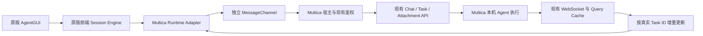

# Tutti Agent GUI 完整 UI 接入

本轮按用户最新要求完整引入 Tutti Agent GUI UI 层，保留源组件、样式、图标、资源、文案与交互，不再将该 UI 改写为 Multica 原生工作台。前两轮的语义化工作台仍保留在代码中，主工作台入口改为 Tutti 的公开 `AgentGUI`。

后续 UI 还原遵循 Multica 的设计规范，通过独立宿主主题适配层消费共享 tokens、真实字体与控件状态样式。第三方源文件继续保持逐字节一致；界面仍由完整 `AgentGUI` 渲染，侧栏和输入区测量逻辑不变。当前设计标准、分工和验收证据见 [UI 还原规格](./tutti-agent-gui-ui-restoration.md)。下文首次接入时的“保持源样式”指保留第三方来源，不代表最终显示仍使用源配色。

## 独立“对话流”标签页

后续按用户要求，将源 GUI 从聊天的 `?view=workbench` 参数视图拆出。当前入口是侧栏“对话流”，路径为 `/{workspaceSlug}/conversations`；桌面通过现有 `AppLink target="_blank"` 与 NavigationAdapter 打开并激活独立应用标签页，同一工作区重复点击复用“对话流”标签页。标签标题固定为“对话流”，使用独立的 MessagesSquare 图标，不再跟着聊天会话标题变化。Web 也有对应路由，侧栏链接打开独立浏览器标签页。

`ChatPage` 已恢复为原始实现，没有工作台切换按钮和 Agent GUI 分支。旧聊天参数不会再替换原界面。源 GUI 的页面组件为 `packages/views/tutti-agent-gui/conversation-flow-page.tsx`：会话与 Agent 选择由它自己的 URL 参数持有，不调用原聊天控制器、不写原聊天的 activeSessionId。取消草稿恢复继续复用按真实 session ID 隔离的既有恢复协议；打开 Task 在桌面使用另一标签页。

独立页面没有旧聊天控制器传入的默认 Agent；冷启动时宿主会从真实目录选择一个可调用且已绑定 Runtime 的 Agent，避免没有初始目标导致原 GUI 的会话列表和编辑器不可用。URL 显式选择的 Agent 或会话不会被该默认值替换。

新窗口回归还确认：焦点进入 iframe 后，浏览器的 `document.hasFocus()` 已为 true，但父窗口的旧 blur 通知曾让前台 hook 缓存为 false，拦住会话地址同步。共享 hook 现在捕获子元素焦点事件，并在焦点转移结束后重新读取真实状态；桥接命令也按当前文档焦点、可见性和路由状态检查。真实后台窗口、隐藏标签页及旧工作区仍不能执行写命令。

旧语义化工作台的专用端到端验收脚本已移至本机 `.tmp/` 留档，不再作为当前产品入口测试。下方首次迁移时的验收命令和截图属于历史记录；现行端到端用例为 `e2e/tutti-agent-gui.spec.ts`，同时覆盖独立入口、原聊天保持原会话、会话切换、Task 导航、附件发送和取消恢复。

本次独立入口的验证结果：

| 验证 | 结果 |
| --- | --- |
| Views：`common/use-app-foreground.test.ts`、`tutti-agent-gui`、`chat/chat-page.test.tsx`、`layout/app-sidebar.test.tsx`、`layout/tab-presentation.test.tsx`、`agent-workspace/agent-task-panel.test.tsx`、`search/search-command.test.tsx` | 9 个文件、140 项通过 |
| `pnpm --filter @multica/core exec vitest run paths` | 88 项通过 |
| `pnpm --filter @multica/desktop exec vitest run src/renderer/src/stores/tab-store.test.ts` | 98 项通过；覆盖独立标签身份、重复打开复用、原聊天 URL 保持 |
| `pnpm --filter @multica/tutti-agent-gui-host test` | 23 项通过 |
| Views、GUI host、Desktop 类型检查；变更涉及的 Views 文件 ESLint；`git diff --check` | 通过 |
| `pnpm --filter @multica/desktop build` | 通过，日志 `.tmp/conversation-flow-desktop-build.log` |
| `make env-exec ARGS='-- pnpm exec playwright test e2e/tutti-agent-gui.spec.ts'` | 1 项通过，25.2 秒；日志 `.tmp/conversation-flow-e2e.log` |

当前 `packages/views/chat/chat-page.tsx` 与本地基线 HEAD 完全一致。没有改动现有 Chat/Task/Attachment API 或上游源 GUI。未重复执行真实付费 Agent 任务。

最终重启桌面后已实际切换两个标签页：原聊天仍显示原会话、原消息列表和编辑器；“对话流”独立显示原版 Tutti GUI、Codex 目录和会话列表。两份截图分别为 `.tmp/tutti-agent-gui-acceptance/native-chat-preserved.png` 与 `.tmp/tutti-agent-gui-acceptance/conversation-flow-tab.png`。

来源基线：`tutti-os/tutti` commit `207beeea554435618dffd3b579d0ffe112b065c4`，模块 `packages/agent/gui`，公开入口 `@tutti-os/agent-gui/agent-gui`。包括必要的前端 activity-core、UI 基础与 workspace UI 依赖，不迁入 tuttid、Agent 执行器、独立数据库或第二个桌面主进程。

## 边界与概念映射

| 源概念 | 接入方式 |
| --- | --- |
| AgentGUI、AgentGUINode、Rail、Timeline、Composer、菜单及弹窗 | 完整源模块，保持源实现与样式，不做组件替换 |
| AgentGUIRuntime 与前端 AgentSessionEngine | 保留公开契约，在宿主适配层连接 Multica 事实来源与命令 |
| Agent Target | 精确的 Multica Agent ID、实际 Runtime、可调用权限与在线状态 |
| Session | Multica ChatSession；已有 ID 直接使用，新建时用持久化双向映射协调源 UI 预先生成的 ID 与服务端 ID |
| Turn | 真实 Multica AgentTask；不从消息内容或显示顺序推断任务身份 |
| Message 与 version | 真实 ChatMessage/TaskMessage 投影；适配器维护会话级投影版本，不把 task 内 seq 当作全局版本 |
| 文件附件 | Multica 上传与附件读取接口；保留真实 attachment ID 和发送绑定 |
| 业务任务引用与打开 | 真实 Issue ID/原任务页面；不把引用文本伪装成额外持久关联 |
| 源用户项目目录 | 不把 Multica Project ID 伪装成文件系统路径 |

源包名、组件名和文件结构作为第三方模块身份保留。目标新增命名只用于宿主、RPC 与 Multica 数据转换。源码、CSS、资源不做机械改名；本地 package metadata overlay 与上游 manifest 分开留存，可根据来源清单复核。

## 不变的后端协议

继续使用现有 `/api/agents`、`/api/chat/sessions`、消息分页、发送、取消、固定、删除、标记已读、附件以及业务任务接口，保持已有字段、鉴权、状态和 WebSocket 事件。用户凭据仅留在 Multica 宿主；子文档通过窄 RPC 请求宿主执行已有 API，不获取令牌，不自行实例化另一条服务器连接。

Tutti 的公开 UI/runtime 协议保持不变。Multica 的数据转换、身份映射与版本账本只存在于外部适配层。发送使用真实 `message_id/task_id`，请求在途去重；服务器没有发送幂等协议时，超时未知结果不能自动重发。

审批响应、Goal 控制、Fork、Plan 实施、任意本地目录写入、VM、Git 补丁和会话内模型修改等缺少对应后端的能力，通过源模块已有的 capability 边界关闭或明确报告不支持，保留完整 UI 源码，不返回虚假的成功结果。

## 渲染与依赖

采用独立 iframe 文档执行源 UI 的根本隔离方案。源 UI 的 CSS、字体、body token、Radix portal 和部分工具视图依赖文档级环境；给 CSS 加前缀或仅使用 ShadowRoot 不能完整隔离。子文档独立 `createRoot`，加载源 UI System、Workbench Surface、Agent GUI 样式及对应 Tailwind 输出，外部 Multica 的主题与组件样式不受影响。

原聊天保持 `/chat` 标签资源身份；源 GUI 使用独立的 `/conversations` 资源身份，两者共用既有工作区路由保护。通过公开 props 和 RPC 注入工作区、Agent 目录、会话、主题与语言。MessageChannel 由宿主检查精确 iframe window 与来源后建立，卸载及工作区变化关闭通道；旧回调不能写入新工作区。

兼容方案是将源 UI 的视觉代码再次映射到 Multica 控件，或把多个组件拼回原工作台。该路线不满足本轮“完整搬入、不原生化”的要求，因此不采用。原有 `@nextop-os/ui-system` 继续服务已有工作台，本轮完整源 UI 使用其真实的 `@tutti-os/ui-system` 依赖，不用旧组件别名冒充。

## 来源与完整性

固定上游为 [tutti-os/tutti@207beeea554435618dffd3b579d0ffe112b065c4](https://github.com/tutti-os/tutti/tree/207beeea554435618dffd3b579d0ffe112b065c4)。
本地源文件放在 `vendor/tutti/packages/`，原目录层级、包名和公开源码入口保持不变。

| 范围 | 保留的包路径 |
| --- | --- |
| Agent UI 与前端状态核心 | `agent/gui`、`agent/activity-core` |
| UI 基础 | `ui/system`、`ui/rich-text`、`ui/react-hooks`、`ui/i18n-runtime` |
| 工作台与浏览器 UI | `workbench/surface`、`workbench/snapshot`、`browser/workbench-node` |
| Connector UI | `connector/renderer`、`connector/contracts` |
| Workspace UI | `workspace/external-core`、`workspace/file-manager`、`workspace/file-preview`、`workspace/file-reference`、`workspace/issue-manager`、`workspace/user-project` |
| UI 所需埋点契约 | `analytics/core` |
| 类型与配置闭包 | `clients/tuttid-ts`、`events/protocol`、`events/stream-core`、`configs/tsconfig` |

共 18 个前端生产包、4 个类型/配置包，保留 2,491 个上游文件，其中包括 2,310 个代码/CSS 文件和 61 个图片或字体资源。
从真实上游 checkout 的 Git 跟踪文件集合，剔除说明中列出的 Agent 指令文件后，与清单中的源文件集合完全相等。
全部源文件内容与当前上游 commit 的 SHA-256 相符；22 个本地包的 `exports` 均与原 manifest 一致，Agent GUI 的 49 个公开源码子路径全部保留。

复核入口：

- [`vendor/tutti/source-manifest.json`](../../vendor/tutti/source-manifest.json)：来源、commit、完整源文件列表、逐文件字节数与 SHA-256，以及本地 metadata overlay 校验值。
- [`vendor/tutti/sync.mjs`](../../vendor/tutti/sync.mjs)：检查上游 commit 与工作区状态，复制 Git 跟踪文件并重建清单；`--verify` 可脱离源 checkout 校验本地文件。
- [`vendor/tutti/README.md`](../../vendor/tutti/README.md)：闭包范围、重建步骤和 manifest 差异政策。
- 每包的 `package.upstream.json`：未经修改的上游 manifest；`package.json` 是本地安装用的独立 metadata overlay。

代表性上游文件校验值：

| 上游文件 | SHA-256 |
| --- | --- |
| `packages/agent/gui/AgentGUI.tsx` | `4d6005205be2ab7ef1223881dff27563ce91b33e7e90e1bee56eb3ed152381cc` |
| `packages/agent/gui/app/renderer/agentactivity.css` | `b997887e9d538426c0d5007ba8ac2b477434ad7600f078669e600315d7a16565` |

这是 UI 代码与资源 vendoring。上游 `AGENTS.md`、`CLAUDE.md` 指令文件明确排除，以免相对路径规则在新仓库失效；测试、包文档、源码、CSS 和资源均保留。执行服务、提供商 CLI、数据库、Git 元数据、安装目录和独立构建输出没有作为源闭包复制。

## 依赖与构建验证

本地 metadata 保留真实运行依赖，固定到上游 lockfile 已解析的版本，并将源码实际需要的类型依赖显式列出。移除的是上游发布/测试工具链和无关的原生开发依赖；完整原 manifest 始终留底。

- 独立 GUI 文档使用 React/React DOM 19.2.6 和 Tiptap 3.23.6。根 `pnpm.overrides` 只对父版本为 3.23.6 的 Tiptap 子依赖固定同版本；Multica 原有 3.31.3 编辑器解析保持原样。
- `RichTextTriggerEditor.tsx` 在运行时导入的四个 Tiptap 基础扩展，从上游开发依赖提升为本地运行依赖，并显式提供 ProseMirror peer。
- 保留 Browser Node 的可选 Electron 版本声明；没有为该声明降级 Multica。React Native 的可选 peer 与上游原生开发依赖没有加入桌面 UI 安装。
- 锁文件保留安装前所有 package 与 snapshot 解析；旧 importer 仅按实际新增的宿主协议依赖增加链接。另补齐安装前基线已存在的 4 个悬空 peer-context snapshot，使用原有包版本与精确 peer 绑定，没有更新原记录的版本。

目前已实际完成的来源与依赖检查：

| 命令或检查 | 结果 |
| --- | --- |
| `node vendor/tutti/sync.mjs --verify` | 2,491 个源文件、22 个 metadata overlay 校验通过 |
| 在固定 commit 的干净 checkout 上运行 `node vendor/tutti/sync.mjs /path/to/tutti-checkout` | 可重建相同源闭包与清单 |
| `pnpm install --frozen-lockfile --ignore-scripts` | 通过，跳过重新解析；没有执行 Agent CLI 或原生安装脚本 |
| 安装前后 lockfile 逐 key 比较 | 原 package/snapshot 全部保留；源码 GUI Tiptap 闭包没有跨版本混用，全锁无悬空 snapshot 引用 |
| `pnpm --filter @multica/tutti-agent-gui-host build` | 独立 Vite 文档构建通过，使用原 Agent GUI 与依赖源码 |
| `pnpm --filter @multica/tutti-agent-gui-host typecheck` | 独立宿主类型检查通过，Multica 全局 TypeScript 规则未放宽 |

源 GUI 自带仅在源码 `exports` 中出现、未包含在上游发布构建入口里的子路径。本次直接由独立 Vite 编译源码入口，因此不依赖上游发布产物的入口覆盖率，也没有用旧 Nextop 包 alias 替换真实 Tutti UI。

宿主构建目前设置 `minify: false`：本次 Vite 8/Rolldown 压缩构建在含 Unicode 的 chunk 引用处理中出现异常，关闭压缩后构建通过。代价是 JS 产物、首次下载与解析成本增加；这仍是交付风险，不能把未压缩产物的构建成功等同于已验证加载性能。调整打包器版本或重新启用压缩时，应同时检查动态 chunk 路径、编辑器和工具视图的按需加载。

构建输出使用相对资源路径，并复制到 Web public 和 Electron renderer public。依赖锁、根 metadata 与来源清单已纳入构建指纹，避免仅依赖变化时复用旧产物。

## 许可证与分发归属

上游 Apache-2.0 [`LICENSE`](../../vendor/tutti/LICENSE)、根 [`NOTICE`](../../vendor/tutti/NOTICE) 和 UI System 的第三方 [`NOTICE`](../../vendor/tutti/packages/ui/system/NOTICE) 均逐字节保留。源文件中的原归属与说明未移除。

宿主构建还将这三份文件与 `provenance.json` 复制到 `dist/licenses/tutti/`，随后带入 Web 和 Electron 静态产物。已逐项确认三处输出中的许可证/NOTICE 与 vendored 原文件哈希相同。

同一工作区与账号、组件仍然挂载的后台页面保留源 GUI 文档与本地 draft 生命周期。源模块的草稿目前属于组件本地状态，公开 API 没有完整草稿快照持久化端口；强制重载、路由卸载或应用重启后的草稿恢复尚未接入。Multica 桌面 `TabContent` 只挂载当前标签，切换桌面标签也会卸载视图，不能将浏览器后台页面的保活验收描述成桌面标签卸载后的草稿恢复。

## 桌面验收结果

### 数据与状态流

会话创建、发送、取消、重命名、固定和附件请求都使用现有服务端对象。消息增量只刷新对应的 Task 输出；会话或执行终态变化再完整回补会话。工作区与账号更换会关闭旧通道；同一工作区的后台页面在组件未卸载时保留子文档，并通过既有 Multica 前台检测同步原版 frame 状态。

已通过桌面原版新建会话与编辑器发起一次本机 Codex 执行：会话 `01a169a9-1239-7a2d-9736-a363f1ffaee5`，返回 `TUTTI_GUI_MULTICA_CONNECTED`，界面显示用时 14 秒。原有真实 Codex 历史也可正常读取。浅色与跟随系统的深色均已在实际 Electron 窗口核对，外部 Multica 与源 GUI 的文档样式独立。

真实执行记录 `01a169a9-126f-700f-b07b-052f8fa941d1` 已在现有 `agent_task_queue` 中核对为 `completed`，没有使用替代执行器。

### 明确的兼容边界

- 源 GUI 的 attention 是真实 `turn:<session>:<turn>:completed|failed` 键；Multica 会话列表的 `has_unread/unread_count` 没有对应 task ID。因此冷启动时其他表面的未读总数尚未映射成源 GUI 的终态徽标，不能用虚构 turn 补齐。已加载真实 turn 的本地手动未读、实时终态及已读回写按源契约处理；外部 Multica 原有未读事实不改变。
- Multica 的旧 `mention://issue/<ID>` 协议保持原样。源 GUI 用户输入的旧 Task mention 不会被改写成源 `workspace-issue` chip；可点击的历史 Markdown 链接通过宿主打开既有 Task 页面。这是保留协议和源富文本实现的兼容限制。
- 项目目录、任意本地文件写入、Goal/Fork/审批等源后端能力没有被伪造；使用源 capability 门禁或明确的不支持错误。源会话“删除”要求可恢复语义，不能映射到 Multica 的硬删除。

### 稳定性修复与验证

接线过程中发现两处可复现的状态循环，均修在 Multica 适配层，未修改上游源 UI：

- 完整历史回填后，重复把所有历史终态当成实时投影，会重新触发原 Session Engine 的回补需求。现在只对仍占用当前 activeTurnId 的终态做一次边界同步；回归用例确认静止历史不会持续读取。
- 会话与任务同时失效时，会话回补完成会启动下一次会话读取；此时遍历实时 dirtyTasks Map，删除并重新加入同一个任务会让迭代器无限访问该项。这是排队任务取消验收时页面卡死的根因。现在使用有限快照排空，并将新会话读取接管的脏任务留到其完成后补读。旧实现的独立最小复现会同步卡死；修复后回归确认最终任务帧没有丢失、队列读取收敛，queued 仍保持 submitted 语义。

HTTP 输出回补成功也会通知对应任务观察者，因此 WebSocket 暂缺的最后一帧可以进入源 GUI；回补只读缓存，不触发完整历史循环。

最终桌面复核还定位了可见性映射错误：源 CSS 的 `data-agent-gui-visible=false` 表示几何遮挡，会设置 `content-visibility: hidden`；宿主曾把 OS 失焦同时映射为不可见，导致后台但仍露出的桌面窗口为空白。现将 `hostVisible`（Multica 是否显示该视图）与 `hostActive`（视图显示且窗口获焦）分开。仅修改宿主公开 frame 的输入，源样式未变；失焦的写命令仍按原保护拒绝。回归覆盖失焦仍可见、切换隐藏视图、恢复焦点且不重建连接。

最终执行结果：

| 验证命令 | 结果 |
| --- | --- |
| `pnpm --filter @multica/views exec vitest run chat/components/use-chat-controller.test.tsx chat/components/chat-input.test.tsx chat/chat-page.test.tsx agent-workspace tutti-agent-gui` | 8 个测试文件、163 项通过 |
| `pnpm --filter @multica/tutti-agent-gui-host test` | 原 Session Engine 适配与 RPC 共 23 项通过 |
| `pnpm --filter @multica/core exec vitest run agents/agent-workspace-queries.test.ts` | 2 项通过 |
| `pnpm --filter @multica/views typecheck`、`pnpm --filter @multica/tutti-agent-gui-host typecheck`、`pnpm --filter @multica/desktop typecheck` | 类型检查通过 |
| `pnpm --filter @multica/views exec eslint agent-workspace tutti-agent-gui chat/chat-page.tsx chat/components/use-chat-controller.ts chat/components/chat-input.tsx` | 通过 |
| `pnpm --filter @multica/desktop build` | 最终 Electron main、preload、renderer 与完整源 GUI 产物构建通过 |
| `make env-exec ARGS='-- pnpm exec playwright test e2e/tutti-agent-gui.spec.ts'` | 1 项严格端到端用例通过，9.1 秒 |
| `make env-exec ARGS='-- pnpm exec playwright test e2e/agent-workspace.spec.ts'` | 原工作台兼容用例独立通过，11.7 秒 |
| `make env-exec ARGS='-- pnpm exec playwright test e2e/tutti-agent-gui.spec.ts e2e/agent-workspace.spec.ts'` | 可见性修复后的最终联合运行：2 项通过，32.9 秒 |
| `node vendor/tutti/sync.mjs --verify`、`git diff --check` | 2,491 个源文件、22 个 metadata overlay 与格式检查通过 |

严格端到端用例覆盖原聊天入口保留同一会话、源 GUI 与既有历史、两会话切换、深浅主题、菜单 portal 留在子文档、Task 链接打开真实 Multica 任务、普通文件真实上传与发送 attachment_ids、取消后恢复文本和附件、重发复用同一附件 ID，以及外部字体不受污染。Headless Chromium 无法提供真实 OS 后台焦点事实，未把自动化窗口切换声称为后台验收。桌面标签卸载后的未发送草稿恢复也不属于已通过项。

最终生产构建日志保存在本机 `.tmp/tutti-final-desktop-build.log`；两套端到端成功日志分别为 `/tmp/multica-tutti-agent-gui-e2e.log` 与 `/tmp/multica-agent-workspace-legacy-e2e.log`，最后联合运行日志为 `.tmp/tutti-final-e2e.log`。深浅主题实际桌面截图保存在 `.tmp/tutti-agent-gui-acceptance/desktop-dark.png` 和 `desktop-light.png`。未做安装包签名、公证、发布或大规模历史性能压测。

用户解锁后，已在可见性修复的最终构建上重新启动托管桌面应用，检查原版 Provider 栏、会话列表、编辑器与真实执行历史。从原生聊天打开同一会话进入源 GUI，正常显示 `TUTTI_GUI_MULTICA_CONNECTED` 与 14 秒总用时；最终窗口截图为 `.tmp/tutti-agent-gui-acceptance/desktop-final.png`。本轮没有重复付费模型调用。后台写命令门禁与可见性分离有独立回归覆盖；不把辅助功能点击等同于真实 OS 焦点切换，也不声称所有多屏/遮挡组合都经过测试。
